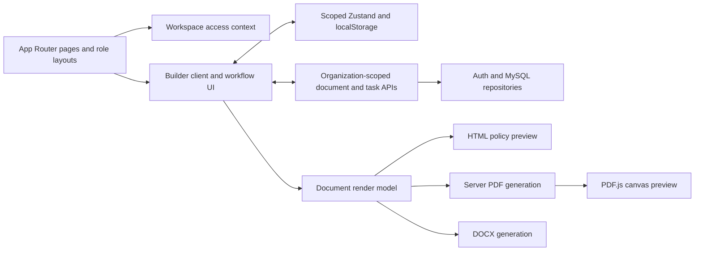

# Target Project Analysis — PolicyCraft

Snapshot date: 7 October 2026. Target: `D:\Policy PoC`; application: `D:\Policy PoC\src`. Inspected revision: `1e2ce7eca88bf1016771a59a9ba07ec8fe413c76` plus the working-tree files present during inspection.

This is a source-level current-state baseline. It records declarations, imports, JSX, CSS, configuration, and state transitions. Visual descriptions describe the styling encoded in source; no browser, screenshots, rendered PDF, or Word output was inspected. Responsive behavior below means the behavior implemented by CSS/JS conditions, not a claim of device testing. Runtime appearance, deployed configuration, assistive-technology behavior, and rendered export fidelity are **Not established from source inspection.**

No existing files or application files were modified. The only file created is this requested report. No packages were installed; no tests, builds, database operations, exports, or browser automation were run. A pre-existing untracked `D:\Policy PoC\DESIGN_SYSTEM_REFERENCE.md` was left untouched and was not used for comparison. No design direction, replacement library, or implementation plan is proposed.

Evidence links resolve to the local checkout. Searches covered production TS/TSX/CSS in the application, important configuration and dependency manifests, public assets, and relevant installed package sources. An absent import is reported as no use located in that scope, rather than proof that a component can never be reached.

## 1. Executive Summary

PolicyCraft is a Next.js App Router application for authoring sustainability policies, managing organization-scoped documents and tasks, and producing PDF/DOCX outputs. It combines a public explanatory page, authentication/onboarding screens, role-specific workspaces, and a multi-step policy builder.

The active application uses custom React UI, Tailwind CSS 4, a global warm cream/forest-green palette, Inter interface text, Fraunces headings, Lucide icons, and a small collection of shared primitives. There is no installed general-purpose component suite such as Radix, Material UI, or Ant Design in the direct manifest. The shared folder is not a complete canonical design system: many pages compose native elements and style them locally.

The builder is a bounded workspace with a collapsible workflow sidebar, central authoring area, document preview, and design inspector. Admin/manager/user workspaces use a separate top-navigation shell. Task screens use a dedicated CSS module; the cover editor uses a slate/green canvas-tool palette; printed documents use independently selectable themes, colors, typography, and physical page geometry.

Motion is implemented through Tailwind transitions/spinners, global entrance and grammar-check keyframes, and local SVG document loaders. No dedicated animation library is declared. Dark mode or an application theme toggle was not located. Document theme selection is active and is separate from application theming.

The main structural variations are locally styled buttons/forms, several overlay implementations, mixed token/literal colors and dimensions, feature-specific density, and uneven keyboard/reduced-motion treatment. These are documented as existing conditions, without selecting changes. Sources: [manifest][package], [root layout][layout], [global styles][globals], [builder shell][shell], [workspace shell][workspace], [task styles][taskcss], [document themes][docthemes].

## 2. Technology Stack

| Area | Current implementation | Evidence / qualification |
|---|---|---|
| Product name | PolicyCraft; manifest name `poc`, version `0.1.0`, private | Root metadata and visible branding differ from the package identifier. [layout][layout], [manifest][package] |
| Framework | Next.js `16.2.12`, declared and installed | App Router; `app/` contains pages, layouts, and route handlers. [manifest][package] |
| UI runtime | React / React DOM `19.2.4`, declared and installed | React function components and hooks. |
| Language | TypeScript/TSX for application UI; JavaScript also allowed | Installed TypeScript `5.9.3`; manifest `^5`; strict/noEmit/bundler resolution. [TS configuration][tsconfig] |
| Styling | Tailwind CSS `4.3.3` installed; declared `^4` | `@tailwindcss/postcss` plus CSS-first `@theme inline`. [PostCSS][postcss], [global styles][globals] |
| Build | `next dev`, `next build`, `next start` scripts | Development output `.next-local`, production `.next`. No separate Vite configuration. [Next configuration][nextconfig] |
| Package manager | `bun.lock` present | A Bun lockfile is evidence of a dependency workflow; the current preferred install/run command is **Not established from source inspection.** No npm/yarn/pnpm lockfile was present alongside the manifest. |
| State | Zustand `5.0.15` installed (`^5.0.14` declared), local component state/context | Scoped persisted builder state plus server documents. [store][store], [builder client][builderclient] |
| Authentication | Better Auth `1.7.5` installed (`^1.3.32` declared) | Credential/session helpers, role/workspace access resolution. [auth][auth], [auth client][authclient] |
| Persistence | MySQL via `mysql2` `3.24.4` installed (`^3.15.2` declared) | Server repositories; UI receives organization/document/task data through API routes. [database][db] |
| AI/import | OpenAI SDK `7.19.0` installed (`^7.3.0` declared); Mammoth and legacy Word extraction | Server generation, grammar and cover/import endpoints. Libraries do not constitute a rich-text UI editor. |
| Document output | HTML render model, Chromium PDF, DOCX, PDF.js preview; React-PDF declared | No React-PDF import located in current app/test/script source; no active path established. |

The installed Next.js CSS documentation was consulted at `D:\Policy PoC\src\node_modules\next\dist\docs\01-app\01-getting-started\11-css.md`. Its CSS/Tailwind/CSS-module structure corresponds to the project configuration; this audit made no application-code edits.

## 3. Dependency & Library Map

Versions below distinguish manifest ranges from inspected installed versions. An installed package alone is not treated as an active screen.

| Category | Package / declared version → installed version | Actual use and scope |
|---|---|---|
| UI/component libraries | Custom components; no direct shadcn/Radix/Headless UI/MUI/Ant/Chakra/Mantine dependency | Shared buttons, fields, panels, modal, calendar, tags, disclosures and toast; many native page controls. [UI primitives][button], [inputs][input] |
| Styling | `tailwindcss ^4 → 4.3.3`; `@tailwindcss/postcss ^4 → 4.3.3` | Widespread utility classes and global CSS; task CSS module is feature-scoped. No SCSS, Sass, styled-components or Emotion implementation located in production styling. |
| Class composition | `clsx ^2.1.1 → 2.1.1` | Imported directly by UI/builder/policy components; no general `cn`/tailwind-merge helper located. |
| Animation | CSS/Tailwind only | No direct Motion/Framer Motion, GSAP, React Spring, Lottie, AutoAnimate or Anime.js dependency/import located. Local loader CSS is embedded in components. |
| Icons | `lucide-react ^1.27.0 → 1.47.0` | Widespread direct icon imports; string-to-icon wrapper in [icons][icons]. Custom inline SVGs also exist. |
| Forms | Native React controls; `react-colorful ^5.8.1 → 5.8.1` | State-driven input/select/textarea/checkbox/radio; custom calendar/combobox; color pickers are limited to theme/cover controls. No React Hook Form/Formik direct dependency. |
| Validation | Custom handlers and native HTML constraints | `required`, type/min/max and feature-specific checks; no Zod/Yup direct dependency/import located. |
| Tables/data grids | Custom semantic tables and mobile row/card alternatives | Admin, manager and tasks; document tables are generated separately. No AG Grid/TanStack Table dependency/import located. |
| Charts | No dedicated chart library located | Progress bars, numeric summaries, SDG visuals and icons exist. A `BarChart3` icon is not chart rendering. |
| Notifications | Custom `Toaster`/`useToast` | Provider in builder route; page-local alerts/status messages elsewhere. No Sonner/React Toastify dependency. [toast][toast], [builder entry][builderpage] |
| Date/time | Custom `DatePicker`/`Calendar`, native date input, date utilities | Builder calendar stores ISO dates and displays DD-MM-YYYY; task deadline uses native `type="date"`. No third-party date-picker library. [calendar][calendar], [task UI][taskui] |
| Drag/resize | `react-moveable ^0.56.0 → 0.56.0` | Cover canvas dragging/resizing/rotation/snapping. Section order also uses native drag handlers and up/down controls; no dnd-kit/React DnD dependency located. [cover editor][covereditor] |
| Carousels | No carousel library located | Galleries/grids/rows and preview navigation; no general slide carousel established. |
| Editors | Custom form-based policy editor, cover canvas, `signature_pad ^5.1.4 → 5.1.4` | Signature drawing is a specific canvas feature; no TipTap/Slate/ProseMirror/Quill dependency located. [signature maker][signature] |
| Font packages | `@fontsource/{allura,bad-script,caveat,mr-de-haviland,pacifico} ^5.3.0 → 5.3.0` | Globally imported signature fonts; document fonts additionally self-hosted. [root layout][layout], [font registry][fonts] |
| PDF display | `pdfjs-dist ^5.6.205 → 5.7.284` | Canvas document preview and worker route; limited to preview/export family. [PDF preview][pdfpreview] |
| PDF generation | `playwright-core ^1.63.0 → 1.63.0`, `@sparticuz/chromium ^147.0.0 → 147.0.2`, `pdf-lib ^1.17.1 → 1.17.1` | Server HTML printing, PDF processing and page metadata; these are output infrastructure. [PDF generator][pdfgenerate], [print renderer][printdoc] |
| Declared PDF renderer | `@react-pdf/renderer ^4.5.1 → 4.9.0` | No current app/test/script import located. The manifest and historical PLAN.md mention it; the active path uses Chromium and `preview-pdf.tsx` re-exports the print renderer. [manifest][package], [preview re-export][previewpdf] |
| DOCX generation/import | `docx ^9.7.1 → 9.7.1`, `mammoth ^1.12.0 → 1.12.3`, `word-extractor ^1.0.4 → 1.0.4` | DOCX/Mammoth are runtime export/import; word-extractor usage located in corpus scripts. No client rich-text toolkit implied. [DOCX generator][docx], [parser][docxparse] |
| Media handling | `sharp ^0.34.5 → 0.34.5` | Server asset/image preparation; client file/image controls are custom. |
| State/auth/server services | Zustand, Better Auth, mysql 2 and OpenAI as in Section 2; `bcryptjs ^3.0.2 → 3.0.3`, `nodemailer ^10.0.13 → 10.0.13`, `dotenv ^17.4.2 → 17.4.2` | State/auth/persistence/generation/mail/configuration services; not additional UI component systems. |

Multiple approaches solve similar problems within custom code: Button vs AIActionButton vs page-native buttons; shared vs handmade overlays; custom vs native dates; global CSS vs task CSS module. React-PDF is declared but its production use was not located, so it is not counted as a competing active renderer. Installed-but-unused animation libraries were not found because no animation package is declared. Whole-program dead-code/removability status is **Not established from source inspection.**

## 4. Frontend Architecture

| Location | Responsibility |
|---|---|
| `D:\Policy PoC\src\app` | App Router route entries, layouts, client page orchestration and server API handlers |
| `D:\Policy PoC\src\components\ui` | Small custom primitive set; not used uniformly by all routes |
| `D:\Policy PoC\src\components\builder` | Workflow shell, policy selection, company setup, section editors, design controls, cover/signature tools |
| `D:\Policy PoC\src\components\policy` | HTML and PDF preview, covers and document loaders |
| `D:\Policy PoC\src\components\workspace` | Role shell, organization listing/source/assignment/editor compositions |
| `D:\Policy PoC\src\components\tasks` | Admin/manager task workflows, progress/status/editor UI and local CSS module |
| `D:\Policy PoC\src\components\templates` | Exported starter/universal catalogs; runtime imports not located |
| `D:\Policy PoC\src\lib` | Client stores/scoping plus domain models, auth/repositories, generation/import, rendering and utilities |
| `D:\Policy PoC\src\public` | Local font files, SDG assets, document-template preview images and starter SVGs |
| `D:\Policy PoC\src\data` | Seed policy content and document-template resources |

`app/layout.tsx` is the global HTML/body/font/CSS entry. It is not a global provider stack: it renders `children` directly. Role layouts wrap content in `WorkspaceShell`; `app/builder/page.tsx` provides `Toaster` around the client builder. `WorkspaceShell` supplies access context; Zustand stores are module-level client stores.

The builder resolves user/access/organization/document state, selects a policy workflow, edits persisted policy state and autosaves server documents. Its local storage is scoped by user/organization. UI state includes selected step, collapsed navigation, open inspector, dialogs and cover-tool state. Server-backed document/task/access state must not be inferred solely from local store state. Sources: [builder client][builderclient], [store][store], [scoped storage][storage], [autosave][autosave], [workspace shell][workspace].

Routing families are detailed in Section 30. `/drafts` reuses the dashboard implementation. `/dashboard` is redirected to `/drafts` by the proxy. `/preview/[id]` currently calls `notFound()`, so its filename does not establish an active document-detail page. [proxy][proxy], [drafts entry][draftspage], [preview route][previewroute].

## 5. Styling Architecture

The central application stylesheet is [globals.css][globals]. It imports Tailwind, declares inline theme variables, sets body/headings/selection/scrollbars, defines reusable class compositions and keyframes, and includes a 1400px cover-editor rule and print background rule. [PostCSS][postcss] connects Tailwind to Next. A `tailwind.config.*` file was not located at the app root; this project uses CSS-first theme configuration.

Production styling in the inspected `app/components/lib` trees has two `.css` files: globals and [tasks.module.css][taskcss]. Most UI geometry lives in JSX utility strings. The HTML policy preview injects substantial local CSS and dynamic variables; the cover editor injects third-party handle overrides; print rendering emits its own physical-page CSS. These are active feature styling layers, not additional app-wide themes.

Measured static occurrences in 81 non-test TSX files under those three trees:

| Pattern | Files containing it | Occurrences | Meaning / limitation |
|---|---:|---:|---|
| `var(--color-...)` | 60 | 1,776 | App color variables are widely referenced. |
| Arbitrary utility syntax `*- [...]` without the separating space | 62 | 2,712 | Includes token references as well as literal values; not a count of hardcoded dimensions alone. |
| Literal hex colors | 28 | 135 | Includes UI, SVG illustration and document presentation values. |
| `style={...}` | 19 | 66 | Common in dynamic geometry, document typography, canvas placement and progress. |
| Native `<button>` | 52 | 274 | Source occurrences, not rendered button count. |
| Shared `<Button>` | 7 | 26 | Demonstrates limited adoption of the shared button wrapper. |
| `transition-all` | 11 | 18 | Used alongside targeted `transition-colors`/transform/width transitions. |

Colors and shadows are centralized more than sizes and compositions. Spacing/radius/type sizes largely use Tailwind defaults or arbitrary local values; there is no extracted application-wide semantic spacing, radius, type-scale, z-index or motion-duration object. Document themes do use typed theme objects and independently resolved design values.

`clsx` combines classes directly. No `src/lib/utils.ts`/general `cn` helper was located. Global `.doc-card` is used; `.editorial-rule` is used on the home page. `.glass`, `.glass-dark` and `.ink-link` are defined but no runtime JSX class usage was located. Those declarations should not be treated as the dominant visual treatment. [global styles][globals], [home page][home].

## 6. Current Design DNA

| Dimension | Source-defined current character |
|---|---|
| Product posture | Enterprise authoring/workspace interface, with a public marketing/explanation page |
| Minimal/decorative | Mostly functional panels, forms and lists; selective gradients, illustration loaders and decorated document covers |
| Color personality | Warm cream neutrals, dark green actions, gold accents, explicit status palettes; slate/sky tooling in the cover editor |
| Typography personality | Serif display headings with compact sans-serif interface copy and occasional mono identifiers |
| Density | Compact builder controls; balanced workspace forms/lists; more spacious home sections and document pages |
| Surfaces | Cream page backgrounds, white panels/cards, muted section headers; borders plus restrained elevation |
| Shapes | Rounded inputs/buttons/panels; pills for tags/status; some square-corner template rows and flatter task regions |
| Hierarchy | Headline/label scale, color, section borders and whitespace; document covers have their own stronger typographic compositions |
| Content emphasis | Policy text and document previews rather than analytics charts |
| Layout emphasis | Navigation/editor/inspector workspace plus top-nav management pages; numeric task summaries rather than a general chart dashboard |

These descriptions are not aesthetic ratings. The home page, operational workspaces, cover editing surface and output documents are materially different visual families. [home][home], [workspace][workspace], [shell][shell], [cover editor][covereditor], [document themes][docthemes].

## 7. Design Tokens

### Actual application color tokens

All are declared in `@theme inline` in [globals.css][globals]. Names record implementation rather than inventing a semantic alias layer.

| Token | Exact value | Observed role |
|---|---|---|
| `--color-ink` | `#0e1a14` | Primary text; some dark actions |
| `--color-ink-2` | `#2d3a32` | Secondary text/navigation |
| `--color-muted` | `#6b7971` | Helper/metadata text; overridden in operational scopes |
| `--color-cream` | `#faf7f1` | Body/workspace background |
| `--color-cream-2` | `#f3eee3` | Muted surface/hover/header fill |
| `--color-paper` | `#ffffff` | Card/input/dialog surface |
| `--color-forest` | `#1a5c3a` | Primary action, selection, brand icon |
| `--color-forest-deep` | `#103822` | Hover/action text/dark green |
| `--color-forest-soft` | `#e8f1eb` | Selected state and soft green fill |
| `--color-forest-mid` | `#2d8a5e` | Mid-green accent; grammar glow also uses RGBA literal |
| `--color-gold` | `#9a7000` | Gold accent |
| `--color-gold-soft` | `#f5ebcf` | Soft accent background |
| `--color-line` | `#e7e2d4` | Soft card/section border |
| `--color-line-2` | `#d2ccba` | Stronger field/outline border |
| `--color-danger` | `#b73a3a` | Declared danger color; red variants also use other literals/default palette |
| `--color-amber-bg` | `#fdf3d2` | Warning background |
| `--color-amber-line` | `#e7d489` | Warning border |
| `--color-amber-ink` | `#7a5b00` | Warning text |
| `--color-blue-bg` | `#e8f0fb` | Information/status background |
| `--color-blue-line` | `#b8d0ef` | Information/status border |
| `--color-blue-ink` | `#1c4e8a` | Information text/toast fill |

There are no separate app tokens named `primary`, `secondary`, `card`, `surface`, `success` or `information`. Existing components map forest/paper/cream/blue values into those roles; this report does not introduce aliases.

### Actual font and shadow tokens

| Token | Value |
|---|---|
| `--font-sans` | `"Inter", system-ui, -apple-system, "Segoe UI", sans-serif` |
| `--font-display` | `"Fraunces", "Times New Roman", Georgia, serif` |
| `--font-serif` | `"Fraunces", Georgia, "Times New Roman", serif` |
| `--font-mono` | `"JetBrains Mono", ui-monospace, monospace` |
| `--shadow-soft` | `0 1px 2px rgba(14,26,20,.04), 0 2px 8px rgba(14,26,20,.04)` |
| `--shadow-card` | `0 1px 2px rgba(14,26,20,.05), 0 8px 24px rgba(14,26,20,.05)` |
| `--shadow-lift` | `0 4px 8px rgba(14,26,20,.06), 0 16px 40px rgba(14,26,20,.10)` |

Tailwind's installed defaults provide `--spacing: .25rem`, breakpoints `sm 40rem`, `md 48rem`, `lg 64rem`, `xl 80rem`, `2xl 96rem`, default radius values and default transition timing. These are dependency defaults, not project-defined semantic tokens. [installed theme][tailwindtheme]. Project-specific CSS/JS thresholds additionally include 1200px and 1400px.

**Repeated literals, not actual shared tokens:** 11.5/12.5/13.5px text; 8/12/14/16px radii; 40/44px fields/actions; 272/68px workflow sidebar, 360px inspector; local red/green colors; z-indices 30/50/100/200/300/999999; 150/200/300ms transitions. Some are shared inside one component or feature but not through a single project-wide token source.

## 8. Color System

The application mixes variable-backed colors, default Tailwind status/slate palettes, literal colors, and document-theme values.

| Current color composition | Evidence and scope |
|---|---|
| Green brand/action | Forest primary plus forest-deep hover; soft forest selection. Shared Button, navigation and forms. [button][button], [workspace][workspace] |
| Warm neutral interface | Cream body, cream-2 secondary fills, paper surfaces, ink/muted text, line borders. [globals][globals] |
| Local muted override | Admin/manager `WorkspaceShell` sets `--color-muted: #5f6e65`; user shell retains the global value. Task styling adds its own scoped treatment. [workspace][workspace], [task styles][taskcss] |
| Green informational border | `#cfe2d7` in InfoBar/Badge, outside the central token declarations. [panel][panel] |
| Danger family | Shared Button/Badge `#fdecec` background, `#9b2929` text, `#f1c2c2` border; Field uses `#c43a3a`; toast error uses `#7a1f1f`; central danger is `#b73a3a`. [button][button], [panel][panel], [input][input], [toast][toast] |
| Page status colors | Red/amber/emerald/blue Tailwind families in administration, invitations, tasks and notices; these coexist with custom amber/blue variables. |
| AI action palette | Button `ai`: `#1a4a4e → #0f3034` teal gradient; AIActionButton primary: `#185335 → #0f3823`, hover `#206c46 → #154d2f`, with amber icon accent. [button][button], [AI actions][aiaction] |
| Cover-tool palette | Background `#edf1ed`, slate control text/borders, blue `#2d9cff` handles, sky/fuchsia guide lines. [cover editor][covereditor] |
| Illustration palette | Document-loader greens/cream/gold, e.g. `#dce5dd`, `#d0dcd1`, `#c6a85a`; local SVG fills. [AI loader][ailoader], [PDF loader][pdfloader] |
| Document palettes | Primary/accent/text/background/border values resolved per theme and optional overrides. They are not application dark mode. [document themes][docthemes], [HTML preview][policypreview] |

Nearly related green values (`#1a5c3a`, `#185335`, `#0f3823`, `#103822`) and red text values (`#b73a3a`, `#c43a3a`, `#9b2929`) coexist. Source does not establish whether their differences are deliberate semantics or historical variation.

Gradients exist in Panel headers (`#fafaf5` to cream-2), AI actions, home-page accent haze and editorial separator, and selected document covers. `.glass`/`.glass-dark` styles are declared but not located in runtime JSX use. No blanket glass theme is established.

## 9. Typography

The UI default is Inter with a system fallback. All headings inherit Fraunces and `letter-spacing: -.015em` from global CSS unless locally overridden. `font-display`, `font-mono`, tracking utilities and explicit sizes refine this per component. Body enables font features `"ss01", "cv11"` and antialiasing. [globals][globals].

The root injects generated self-hosted `@font-face` rules from the document font registry, so document fonts are globally available. It separately imports Allura 400, Bad Script 400, Caveat 600, Mr De Haviland 400 and Pacifico 400 from Fontsource for signatures. No `next/font` use or remote Google Fonts loading was located in the active root layout. [layout][layout], [fonts][fonts]. Availability of fonts in the deployed runtime is **Not established from source inspection.**

| UI role | Current examples |
|---|---|
| Workspace/page title | Fraunces `text-2xl`/`text-3xl`; task title 28px desktop/24px mobile |
| Home display | 40/48px section headlines and larger responsive hero text; tight line-height and tracking |
| Panel/card title | Panel 15px semibold; home card 15.5px; other cards use `text-sm`/`text-base` |
| Body | Compact 12.5/13/13.5px in authoring/metadata; 14px workspace copy; 16px explanatory/CTA copy |
| Form label | Shared Field 11.5px semibold uppercase/tracking-wide; login/workspace forms commonly 14px mixed-case labels |
| Helper/error | Shared Field 11.5px with leading-snug; page-native forms use 12/14px |
| Buttons | Shared 12.5/13.5/15px medium; AIActionButton semibold; many native workspace actions 14px semibold |
| Navigation | Workspace links 13px medium; actor 12px and role 10px; builder navigation varies with expanded/compact state |
| Tables | Tasks body 13px; header 11px uppercase/tracked; other workspace tables use 12px/14px patterns |
| Badge/tag | Badge 11px semibold/tracking-wide; Tag 12.5px medium |
| Metrics | Task summary value 25px desktop/22px mobile; tabular numerals occur in count/progress labels |
| Identifiers | JetBrains Mono, usually 10.5–12px for document IDs, step numbers and dates |

No single named UI type scale exists beyond font families and Tailwind defaults. Size/weight/case vary by feature; the shared Field and operational labels are visibly different in source. Task CSS can force an Inter-based operational scope while global heading inheritance is serif. Document body/header/footer typography is separately resolved in points and CSS variables, covered in Sections 27 and 31.

Line-height treatments include `leading-tight`, `leading-snug`, `leading-relaxed`, `leading-6`, 1.05 on home display and literal 1.6/1.65/1.7 on explanatory copy. Tracking ranges from tight headings to `.14/.16/.18em` overlines. This is a collection of current patterns rather than a centralized typography specification.

### Self-hosted face coverage

The following weights/styles are declared in the font registry. Italic availability does not mean every listed weight has an italic face. Source declarations do not prove a particular face is downloaded on every page. [font registry][fonts].

| Family | Declared weights | Italic face declared? |
|---|---|---|
| Inter |400,500,600,700,800 |No |
| Fraunces |400,600,700,900 |Yes |
| Space Grotesk |400,500,600,700 |No |
| Archivo |400,600,700,800,900 |No |
| Source Sans 3 |400,600,700 |Yes |
| Source Serif 4 |400,600,700 |Yes |
| IBM Plex Sans |400,500,600,700 |No |
| IBM Plex Serif |400,600,700 |Yes |
| IBM Plex Mono |400,500,600,700 |No |
| Libre Caslon Text |400,700 |Yes |
| Cormorant Garamond |500,600,700 |Yes |
| Playfair Display |600,700,800 |Yes |
| Atkinson Hyperlegible |400,700 |Yes |
| Caveat |500,600,700 |No |
| Public Sans |400,600,700,800 |No |
| JetBrains Mono |400,600,700 |No |

## 10. Spacing & Density

| Surface/composition | Existing spacing |
|---|---|
| Workspace shell | Horizontal 20px, increasing to 40px at `lg`; main vertical 28px, increasing to 36px at `lg`; max-width 80rem |
| Builder header/content | Header `px-7 py-4`; content `px-6 lg:px-10 py-8`, max-width 7xl |
| Home sections | `px-8 lg:px-14`, commonly 80px vertical sections and 96px final CTA; varied 12-column compositions |
| Draft page | `px-6 lg:px-12`; grid gap 16px; own page composition inside role shell |
| Shared Panel | Header 24px horizontal/16px vertical; body 24px horizontal/20px vertical |
| Shared Field | Label/control/helper gap 6px |
| Shared Input | 40px tall, 14px horizontal padding |
| Shared Button | 32/40/48px tall; 12/16/20px horizontal padding; 6/8/10px icon gaps |
| Workspace actions | Frequently minimum 44px height, 16px horizontal padding |
| Shared Modal | 16px outer gutter; 28px body/header horizontal inset; 20–28px vertical treatment |
| Tasks | 22px section spacing, 20px vertical table-cell padding; dialogs 24px desktop/20px mobile |
| Disclosures | 44px square action trigger; panel 6px padding; actions minimum 44px |
| Calendar | 14px popover padding, 4px grid gaps, 32px day cells |
| Toast | 16×12px padding, 10px icon gap; viewport offset 24px bottom/right |

Tailwind's quarter-rem scale is widely used, supplemented by half-step utilities and arbitrary values. Physical document spacing and canvas coordinates use a separate mm/point-based system. There is no single density setting shared across builder, operational tasks, public page and document output. Sources: [global CSS][globals], [shell][shell], [workspace][workspace], [Panel][panel], [inputs][input], [Modal][modal], [calendar][calendar], [tasks][taskcss].

## 11. Borders & Radius

Borders are predominantly solid 1px. Input/outline controls use line-2; cards and separators use line. Dashed borders indicate upload/empty/editor areas. Focus rings/outlines and selected states add stronger green or feature-specific blue outlines.

| Element | Current treatment |
|---|---|
| Shared Button/Input/Select | `rounded-lg` = 8px with installed defaults |
| Shared doc-card/Panel | Literal 14px radius; header inherits parent radius |
| Shared Modal | `rounded-2xl` = 16px |
| Login panel | `rounded-3xl` = 24px |
| Toast/disclosure panel/calendar | Commonly `rounded-xl` = 12px |
| Badge/Tag | Fully rounded pill |
| Workspace page cards | Commonly `rounded-xl`/`rounded-2xl`; border styling local |
| Task controls/dialogs | 6/8px local radius rules; flatter/border-separated page regions |
| Cover editor | 16px outer editor radius; 12px tool controls; paper canvas is rectangular |
| Tables | Parent/card border and row separators; no single radius-bearing table component |
| Starter catalog actions | Square-corner inline actions in open rows; exported catalog not established as reachable |
| Navigation | Workspace active/hover areas generally 8px; builder sidebar has local rounded step regions |

The dominant application shape language is rounded, with pills for selections/status and rectangular document pages. Radius is not centralized as a PolicyCraft semantic token. [button][button], [inputs][input], [Panel/Badge][panel], [modal][modal], [task CSS][taskcss], [Tailwind defaults][tailwindtheme].

## 12. Shadows & Elevation

Three application shadow tokens exist (Section 7), alongside default Tailwind shadows and literal component shadows.

| Role | Current implementation |
|---|---|
| Card/panel | `.doc-card` soft shadow; some hover states use shadow-card |
| Emphasized preview/login | shadow-lift; home preview also uses it |
| Modal | shadow-lift plus dark translucent blurred backdrop |
| Toast | shadow-lift on saturated status surfaces |
| Combobox | `0 12px 28px rgba(38,50,42,.16)` |
| Calendar | `0 12px 32px rgba(35,52,42,.16)` |
| Action disclosure | `0 16px 44px rgba(29,45,36,.16)` |
| AI popover | Tailwind shadow-2xl; AI button shadow-sm/hover shadow-md |
| Cover editor | `0 14px 45px rgba(31,46,36,.08)`; handle shadow `0 1px 3px rgba(15,23,42,.25)` |
| Selected Tag | `0 1px 2px rgba(26,92,58,.15)` |
| Document preview | Page shadow in preview CSS; print CSS explicitly removes shadows |

Hierarchy uses borders, tinted background changes and spacing throughout routine workspace UI; shadows emphasize cards, overlays and document paper. There is no global numeric elevation scale. Native `title` tooltips do not have an application-controlled shadow/style. [globals][globals], [input][input], [calendar][calendar], [disclosure][disclosure], [AI actions][aiaction], [cover editor][covereditor], [print renderer][printdoc].

## 13. Application Shell

| Shell/layout variant | Current structure and dimensions |
|---|---|
| Global root | English HTML, minimum-height flex-column body, global CSS/fonts; no global header/sidebar/footer/provider stack. [layout][layout] |
| Public home | In-flow header/nav, max-width 7xl, 32px/56px horizontal gutters; editorial hero/content sections and simple footer. Hero grid becomes 12-column at `lg`; headline 56px → 80px. Header is not declared sticky/fixed. [home][home] |
| Workspace | White border-bottom header, role-based top links, actor identity/sign out, skip link, max-width 7xl content. Two header rows below `lg`, one row at `lg`. No sidebar or footer in this shell. [workspace][workspace] |
| Builder | `h-screen overflow-hidden` flex workbench; 272px expanded / 68px collapsed workflow sidebar at 1200px+, 280px mobile drawer; brand/header row approximately 65px; central header and independently scrolling step content. [shell][shell] |
| Design inspector | 360px right panel at 1200px+; fixed right drawer capped at `min(100vw,360px)` below that width, with scrim. State-controlled mount; four tabs. [inspector][inspector] |
| Company setup / policy selector | Setup and type-selection compositions preceding the bounded multi-step workspace; central forms/type options, distinct from management top navigation. [setup screen][setupscreen], [selector][selector] |
| Cover editor | Bordered tool workspace with tools/canvas/properties, scrollable drawing region and physically proportioned A4 surface; UI scale and document scale are separate. [cover editor][covereditor] |
| Login/invitation | Centered narrow white rounded card on cream page; login max-width md, 32px card padding. Not wrapped in role navigation. [login][login], [invitation][invitation] |
| Document preview | HTML preview max-width 4xl with document-specific layout; PDF canvas preview toolbar, horizontal overflow, minimum content height 480px. [HTML preview][policypreview], [PDF preview][pdfpreview] |

The builder sidebar width transitions, while its central area scrolls inside a full-height shell. Mobile sidebar/inspector are fixed overlays. Shared modals/toasts/AI popovers use portals or fixed positioning with independent stacking. The workspace header remains in document flow; a universal sticky header is not established.

## 14. Navigation

The workspace shell defines role-specific links: admin has Managers, Organizations, Policies, Tasks and Administration; manager has Organizations & policies and Tasks; user has Policies. Active matching includes nested route families and uses soft-green fill/dark-green text plus `aria-current="page"`. Hover uses cream-2/forest, default ink-2, and focus-visible green outlines. Manager task counts appear as green pills and in the accessible link label. At narrow widths links wrap on a second header row; there is no hamburger substitution in this shell. [workspace][workspace].

Builder navigation is a policy-dependent step sequence, not separate page URLs per step. Expanded sidebar buttons include labels and step indicators; compact sidebar uses icons and exposes current-step ARIA. Step clicks update the client store and reset inner scroll. Selected/visited/current positions are represented with local colors and progress, but workflow position is separate from saved section completeness. Sidebar collapse persists in localStorage. Mobile navigation uses a 280px drawer/scrim; Escape, focus wrapping and focus return are implemented locally. Keyboard shortcuts include Ctrl/Cmd+B for inspector and Ctrl/Cmd+[ or backslash for sidebar. [shell][shell], [store][store].

The design inspector has Templates, Design, Document and AI covers tabs with border-underlining/color and tab/panel IDs. The inspector is conditionally mounted; no slide-in transition is defined. Organization section navigation is a wrapping underlined link row. Draft Active/Archived controls expose tab selection; policy-type filters are chip/button compositions. Task tabs and filter selection use their own scoped visual rules. [inspector][inspector], [organization navigation][orgnav], [draft page][dashboard], [task UI][taskui].

Home navigation consists of anchor links to How it works/Standards plus workspace/login/session actions. Detail/create screens use local breadcrumb/back links rather than a global breadcrumb component. Row action disclosure panels intentionally retain ordinary Tab order instead of emulating an ARIA menu; pointer/focus-out/Escape close them. [home][home], [disclosure][disclosure]. Disabled/loading actions are local native button states; there is no global disabled navigation design.

## 15. Buttons

### Shared Button

`Button` is a `forwardRef` native-button wrapper. Common rules: inline flex, centered content, 8px radius, medium weight, `transition-all 150ms`, active scale `.98`, disabled opacity `.5` and not-allowed cursor. A loading state disables it and replaces the leading icon with a 14px border spinner; trailing icon is omitted while loading. No automatic `aria-busy` or live announcement is added. No custom focus class is supplied by the wrapper; caller/browser focus behavior remains. [button][button].

| Variant | Background/text/border | Hover |
|---|---|---|
| Primary | Forest / white / forest | Forest-deep background and border |
| Secondary, default | Paper / ink / line | Cream-2 background |
| Outline | Transparent / ink / line-2 | Cream-2 background |
| Ghost | Transparent / ink-2 / transparent | Cream-2 background |
| Danger | `#fdecec` / `#9b2929` / `#f1c2c2` | `#fbe0e0` background |
| AI | Teal gradient `#1a4a4e → #0f3034` / white / `#0f3034` | Brightness 110% |

| Size | Height | Horizontal padding | Font size | Gap |
|---|---:|---:|---:|---:|
| sm | 32px | 12px | 12.5px | 6px |
| md | 40px | 16px | 13.5px | 8px |
| lg | 48px | 20px | 15px | 10px |

### Other active button systems

| Implementation | Geometry/visual states | Scope and differences |
|---|---|---|
| AIActionButton | 32px/36px, 12/14px padding, 12.5/13.5px semibold, 8px radius; green gradient primary, secondary/outline/ghost; 200ms all transition, hover shadow/gradient, primary active scale | Generation-option popover; loading disables and displays Loader2. Its primary palette and medium size differ from Button. No explicit shared focus/disabled-opacity rules. [AI actions][aiaction] |
| Workspace-native primary/outline/destructive | Common minimum 44px, 14px semibold, 8px radius; forest or local red/amber palettes; focus-visible and disabled styles often explicit | Admin/manager/org forms and confirmations; class strings repeated across pages. [admin][admin], [policies][adminpolicies], [manager][manager] |
| Task-native controls | 40px minimum; CSS module controls focus/radius/type/transition; field/action geometry may override JSX utilities | Scoped task system rather than Button wrapper. [task UI][taskui], [task styles][taskcss] |
| ActionDisclosure trigger/items | 44px square trigger; minimum 44px rows, 8px corners, 14px medium; forest focus; destructive red text/fill | Reused row actions; busy/disabled states prevent interaction. [disclosure][disclosure] |
| Inspector/preview/canvas controls | Common 28/32px compact buttons, 11/12px type; icon buttons and grouped toggles; cover tools also use 44px rows | Feature-local geometry, borders and focus patterns. [inspector][inspector], [PDF preview][pdfpreview], [cover editor][covereditor] |
| Text/link-like actions | Inline text buttons and real Link/anchor elements; often green text, hover underline | Password/email choice, clear filter, Today, back navigation. No universal text-button variant. |
| Catalog actions | 40px square-corner Preview/Use actions in starter rows; other catalog uses card-local actions | Runtime catalog use not established. [starter catalog][startercatalog] |

Primary/secondary/outline/ghost/danger exist as shared variants; text/icon-only/link behavior is usually composed locally. There are multiple button families, with no universal loading/focus/height policy enforced at the component boundary.

## 16. Forms

| Control | Existing implementation and states |
|---|---|
| Field | React label/hint/error wrapper; 6px vertical gap; 11.5px uppercase semibold label; required asterisk/error `#c43a3a`. The label has no `htmlFor` and does not contain children; linkage is not automatic. Errors are visual text, with no automatic `aria-invalid`/`aria-describedby`. [inputs][input] |
| Input | Native `input`, 40px high, 14px horizontal padding, 8px radius, line-2 border, paper background, 13.5px text, muted placeholder. Focus removes outline and replaces it with forest border/2px low-opacity ring. Native props passed through; generic disabled/error/success visual variants are not built in. |
| Textarea | Same base with auto height, 8px vertical padding, relaxed line-height, vertical resize; minimum 100px when rows omitted. Adds grammar-on-blur behavior for trusted manual edits, checking data attribute/glow and success/error toast. Edit/scope checks prevent overwriting newer text. Not merely a presentational textarea. |
| Select | Native select with shared 40px base, custom SVG chevron and `appearance-none`; focus follows base. Options/validation remain caller-managed. |
| Combobox | Editable Input plus clear/open buttons, case-insensitive local option filtering, 224px maximum list height, z-index 30 dropdown, selected green state. Role=listbox/options and expanded state; closes outside mousedown. No arrow-key active-option/aria-activedescendant logic found. |
| Checkbox / multiselect | Native controls in section/SDG selections, organization assignments and switches/options; forest accents, wrapped labels in several forms. Multi-selection is lists/chips, not a third-party multiselect component. |
| Radio | Native radio controls in typed signature style selection and feature choices; no common Radio wrapper located. [signature maker][signature] |
| Switch / segmented controls | FY/CY, document view, preview modes and boolean options are button groups/native checkboxes. A shared switch component was not located. |
| Search | Native inputs with icons/local styling in policy/org/manager lists and template galleries; some filters synchronize query parameters, others stay local. |
| Date | Custom DatePicker aliases Calendar; 40px trigger, DD-MM-YYYY display/ISO storage, min/max range, month/year selectors, today/clear; task editor uses native date input. [calendar][calendar], [task UI][taskui] |
| Time | A standalone time picker/control was not located in inspected UI. Task deadlines explicitly use end-of-day India Standard Time. |
| File upload | Hidden/native file input plus label/button/drop-area; logo/feature images/signatures/manual cover images and DOCX import. Accepted formats and validations differ by workflow. [company form][companyform], [signature][signature], [cover editor][covereditor], [builder client][builderclient] |
| Color | React Colorful plus HEX/control inputs in theme/cover tools; anchor/popover ownership differs from calendar and AI popup. [theme inspector][themeinspector], [cover editor][covereditor] |

Operational forms frequently bypass the shared base: login and standalone-org fields are 44px, 14px text, mixed-case labels and focus-visible outlines. Task modal fields use native controls then feature CSS overrides. Inline validation, native required/type constraints, top-level alerts, save/reload conflict messages and submit-disable rules coexist. There is no centralized form engine or shared success-border convention. Labels are properly nested or connected in many workspace/auth forms, while the generic Field's label does not establish that association by itself.

## 17. Cards

| Family | Structure and visual treatment | Current usage |
|---|---|---|
| doc-card / Panel | White, line border, 14px radius, soft shadow; optional gradient header, title/icon/actions; padded body; no automatic footer | Builder sections and some home/preview compositions. [Panel][panel] |
| Draft document card | Horizontal flex, miniature cover (72×102px approximately A4 ratio), title/metadata/ownership/actions/resume; local borders/radius/hover | User policy list; 1→2-column outer grid at 640px. [draft page][dashboard] |
| Manager policy article | Cover 64×88px, policy/organization metadata and actions; stacked on narrow width, horizontal at sm | Manager all-org/selected-org policy list; not a desktop table. [manager][manager] |
| Operational white panel | Rounded-xl/2xl border, local shadow, header/filter/body/footer sections | Admin policies/managers, organization editors and account administration. |
| Mobile record article | Local bordered/separated record with label/value fields and action group | Responsive alternatives to manager-account, policy and task tables. |
| Task summary | Four numbers separated by borders/spacing, not a universal KPI Card component | Scoped task pages; 25/22px values. [tasks][taskcss] |
| Information/warning region | InfoBar rounded green/amber; page-native red/amber/emerald notices | Builder hints, auth/admin status/conflict/error messages. [Panel][panel] |
| Theme/gallery tile | Cover/body miniature, selected border/ring and label/actions; CSS miniature fallback | Active document theme chooser and public/my template tooling. [theme picker][themepicker], [theme inspector][themeinspector] |
| Public feature card | doc-card p 5, icon block and step metadata, hover border/shadow | Home workbench explanation; spacious sections. [home][home] |
| Auth panel | White 24px-rounded elevated card, branding/header/form | Login/invitation family. |
| Catalog entries | Starter open rows vs universal rounded bordered cards | Exported components with no runtime use located. [starter][startercatalog], [universal][universalcatalog] |

White bordered rounded surfaces recur, but there is no single Card abstraction covering all families. Profile/account identity is embedded in rows/forms; chart-specific cards were not located because no chart implementation was established.

## 18. Tables & Data Grids

The application uses custom HTML tables and list/article alternatives. There is no installed advanced grid/table engine. Row height is content/padding driven, not a global fixed height.

| Screen/system | Header, cells and geometry | Controls and responsive behavior |
|---|---|---|
| Admin managers | Semantic four-column table: Manager 28%, Organizations 40%, Access 12%, Actions 20%; px 4/5, py 4 body cells; local header typography/borders | Search name/email/org, access select, row disclosure/actions; table at xl+, stacked articles below. No user sorting/pagination/bulk-selection controls found. [admin][admin] |
| Admin policies | Policy 42%, Organization 22%, Owner/updated 18%, Actions 18%; white panel and row separators | Title search, org/creator/type filters, active/archive; table lg+, article/detail cards below. Archive/restore/delete row actions; no sorting/pagination/bulk found. [policies][adminpolicies] |
| Admin tasks / manager work | Feature CSS: header 11px uppercase/tracked, body 13px, 13px header vertical / 20px body vertical padding, row hover/focus-within fill | Filters/status/deadline/search, edit/cancel/history and manager-work expansions; main task table xl+, cards below. [admin tasks][admintasks], [task styles][taskcss] |
| Manager tasks | Same task UI/status/progress family | Main table lg+, cards below; start/open/complete and task-context handoff. [manager tasks][managertasks] |
| Policy document tables | Theme-specific HTML/print/DOCX table recipes for targets, responsibility/revision/control information | Read-only output tables; no data-grid sorting/editing. [HTML preview][policypreview], [DOCX][docx] |

Manager policies and organization listings are lists, not tables. Form-repeaters for sites/targets are editing compositions, not a cell-editable grid engine. No global selected-row state or bulk action toolbar was located in these listing views. The manager aggregate explicitly sorts documents by updated time in source; that is separate from a user-controlled sorting UI.

Desktop headers/row styles are locally composed except the scoped task family. Mobile behavior generally replaces the table with labeled articles instead of shrinking every column; document tables follow document theme/mobile CSS. No generic pagination widget was located. This absence is scoped to the inspected current screens rather than a claim about every possible API response.

## 19. Badges & Status

Shared `Badge` supports forest, amber, blue, muted and danger palettes; it is a span pill with border, 10px horizontal/4px vertical padding, 11px semibold tracked text. It supplies color variants, not a global semantic status vocabulary. `Tag` is a selectable button pill, 14px/6px padding, 12.5px medium text, border and 150ms transition, selected green and subtle shadow. It does not automatically set `aria-pressed`. [Panel][panel], [Tag][tag].

| Status family | Actual labels/states and styling |
|---|---|
| Tasks | Assigned, In progress, Completed, Cancelled; overdue deadline replaces visible status label with Overdue. 28px minimum rounded-md bordered chip, 11px semibold and 13px icon; sky assigned, forest in progress, emerald completed, warm muted cancelled, red overdue. [task UI][taskui] |
| Managers/access | Active, Disabled, Invitation pending, Invitation not sent, Invitation expired; soft emerald/amber/slate local chips. [admin][admin] |
| Organization source | ESG / PolicyCraft; 10px fully rounded bordered chip, 8px horizontal padding. Standalone forest-soft/forest vs ESG cream-2/muted. [source labels][orgsource] |
| Organization availability | Deleted/expired messaging, sometimes source/availability metadata; edit access presentation depends on role/source |
| Documents | Active/Archived filters and labels; draft ownership/type/updated metadata; save state is separate |
| Builder save | Saving/Saved/Conflict/Offline and relevant error/banner controls; backed by autosave state |
| Task counts/progress | Open-task count pill, numeric filled-section labels and progressbar; unavailable/waiting progress copy |
| Home/selector | Small status dots/eyebrows/chips for feature/policy context; no unified status-dot component |

Status semantics and palettes are feature-specific. Badge, TaskStatus, OrganizationSourceBadge and native page spans coexist; source badge describes origin, not success/failure. [workspace][workspace], [task UI][taskui], [orgsource][orgsource].

## 20. Modals / Drawers / Overlays

| Overlay | Library/geometry | Close and interaction behavior |
|---|---|---|
| Shared Modal | Custom portal to body, z-index 100, default 460px width, max `100vw−32px`, max `100dvh−32px`; paper/16px radius/lift shadow; backdrop `rgba(14,26,20,.4)` plus blur; 28px inset | Close control/Escape invoke callback, local Tab trap, initial dialog focus, focus restoration, body-scroll lock. Backdrop has no outside-click-close handler. `hideClose` hides control, not the Escape handler. [Modal][modal] |
| TaskModal | Wraps shared Modal with CSS-module dialog content | Uses shared focus/close mechanics; scoped CSS alters dialog radius/padding and controls. [task UI][taskui], [task styles][taskcss] |
| Draft rename/delete | Hand-built fixed overlay in dashboard implementation | Outside mousedown close, local close/cancel/actions; rename autofocus. Shared Modal focus trap/Escape/body-lock behavior is not supplied by these implementations. [draft page][dashboard] |
| Starter/universal previews | Handmade labeled dialog overlays within exported catalogs | Outside-click handling; no focus-management/Escape code located in those components. Runtime use not located. [catalogs][startercatalog] |
| Builder mobile sidebar | Fixed left 280px drawer and scrim below 1200px | Local Escape/focus wrap/restore, menu/close controls. Desktop switches to bounded sidebar/collapse. [shell][shell] |
| Design inspector mobile | Fixed right, `min(100vw,360px)`, z-index 40; scrim z-index 30 | Close/scrim/Escape and local mobile focus handling; static panel at 1200px+. No drawer animation defined. [inspector][inspector] |
| AI generation popover | Custom body portal, fixed measured top/right, 320px →384px at sm, z-index 999999, 12px radius/shadow-2xl | Outside mousedown closes; generation/back/menu modes; repositions on scroll/resize. No shared Modal focus trap/escape or dialog semantics added. [AI actions][aiaction] |
| Calendar | Absolute, z-index 50, 290px →310px at sm, 14px padding/12px radius/literal shadow | Trigger Enter/Space/Escape, click-away, today/clear/month/year/day controls; no full roving-date keyboard/focus trap established. [calendar][calendar] |
| Combobox list | Absolute z-index 30, full input width, max-height 224px, 8px radius | Click-away/options/clear; focus handling differs from ActionDisclosure. [inputs][input] |
| ActionDisclosure | Absolute aligned right, min-width 208px, z-index 50 panel/z-index 30 opened root, 12px radius | Pointer-out, focus-out, Escape and selection close; Escape/selection returns focus to trigger; ordinary Tab order. [disclosure][disclosure] |
| Theme/color popup | React Colorful inside custom positioned controls; single open-color state | Outside-pointer close against anchor/picker; independently controlled by theme inspector. [theme inspector][themeinspector] |
| Tooltips | Native `title` attributes and local hover descriptions | No shared accessible tooltip primitive/library established. |

There are several overlay interaction systems, despite a shared Modal existing. Portals and local absolute panels have different scroll/clipping and stacking behavior. For canvas/tool popups, exact runtime viewport collision handling is **Not established from source inspection.**

## 21. Feedback UI

Builder `Toaster` owns success/error/info notifications in a body portal, bottom/right 24px, z-index 50, vertical gap 8px, max-width sm. Toasts have 12px radius, 14px medium text, lift shadow, entrance fade-up, a 16px Lucide icon and saturated green/error-red/blue background. They auto-remove after 3500ms; no dismiss button, pause timer or ARIA live-region role is defined. The context is mounted by the builder entry, not globally across workspaces. [toast][toast], [builder entry][builderpage].

`InfoBar` provides soft green info or amber warning boxes; pages also compose red/amber/emerald banners directly. Many operational async updates explicitly use role=alert/status and aria-live, so notification semantics vary by implementation. Grammar correction uses the shared textarea data attribute and pulsing field border/shadow plus toast. [inputs][input], [Panel][panel], [admin][admin], [org editor][orgeditor].

Progress uses width-driven bars and numeric labels. TaskProgress exposes role=progressbar/values and filled-section text; builder navigation progress represents step position; export completeness and task completion are separate data concepts. Spinners are Lucide Loader2 or border spinners. AI cover/PDF generation use local SVG document loaders; static/error versions differ. No shared Skeleton component or general animated skeleton system was located. [task UI][taskui], [shell][shell], [export step][stepexport], [AI loader][ailoader], [PDF loader][pdfloader].

## 22. Loading / Empty / Error

| Family | Current states |
|---|---|
| Workspace access | Full-screen centered loading status; failure message/retry; redirects for missing session/wrong role; sign-out failure/retry banner |
| Login | Submit spinner/disabled button; inline alert; separate message when sign-in succeeds but workspace load fails; Suspense fallback is a background-only main |
| Invitation | Checking, unavailable/retry, new-account creation/accepted/sign-in continuation, existing-account acceptance, redirect errors |
| User documents | Loading, load-error/retry, no documents, no filtered results; active/archive list and rename/delete flows |
| Admin managers/policies | Loading, API failure/retry, empty collection vs no filtered matches, filter reset; invitation delivery/assignment/action errors |
| Organization list/editor | Loading, retry failure, no organizations vs no search matches, created notice; save validation/conflict and Reload latest profile |
| Manager workspace | No assigned organization, all-org/document loading failure, notice, empty/no-match policy list and clear filters |
| Tasks | Loading/error/empty tasks; assigned/in-progress/completed/cancelled; overdue; progress unavailable/waiting-for-first-save; action/save-completion gating |
| Builder | Hydration/access/save errors; Saving/Saved/Conflict/Offline; import/generation/export busy and failure; task incomplete-section confirmation |
| PDF preview | Initial render loader, stale document dimming during update, page rendering errors/retry, ready state and download-match copy |
| Route stubs | `/preview/[id]` and `/templates` call `notFound()`; no active detail/catalog render at those route entries |
| Global 404/error UI | Custom root `not-found.tsx`/`error.tsx`/`loading.tsx` was not located in route inventory; exact framework-rendered 404 appearance is **Not established from source inspection.** |
| Unavailable feature | Access/organization/task-specific notices exist; no generic feature-entitlement unavailable screen was located |

Messages and retries are often page-local rather than a shared EmptyState/ErrorState primitive. Some loading branches announce live status, some only render text/spinner. Source demonstrates deliberate differentiation of empty collection and filtered-empty lists in several workspaces, but no universal format. [workspace][workspace], [login][login], [invitation][invitation], [dashboard][dashboard], [admin][admin], [policies][adminpolicies], [org list][orglisting], [manager][manager], [PDF preview][pdfpreview].

## 23. Icons

Lucide React is the active application's dominant icon library. Imports appear across shared UI, navigation, steps, administration, tasks and document tooling. Common sizes are 13/14/15/16/18/20px, with larger decorative home/loader elements. Most interface icons are strokes using currentColor; status/surface classes set forest, muted, white, amber, red or slate color. Some use explicit stroke widths 1.6/1.8. [icons][icons], [workspace][workspace], [home][home].

`Icon` maps string names to Lucide components, defaults 16px, and falls back to Circle for unknown names. `StepIcon` adds text-current. The wrapper's declared `strokeWidth` prop is not forwarded in its implementation; direct icon imports can pass it themselves. Custom inline SVG chevrons, document loader illustrations and cover art also exist. SDG pictograms are image assets with official goal colors.

Decorative `aria-hidden` is common in workspace/task UI, but not automatic in the icon wrapper or every shared/toast/calendar icon. Icon-only buttons usually rely on local aria-label/title; the AI popover's X/back-mode button has no accessible label in its JSX. The root standalone `PolicyCraft.html` loads Tabler webfont 3.19.0 via CDN, but no active app import/reference to that file was located; it is not evidence of a second runtime icon library in the Next UI.

## 24. Images & Assets

| Asset family | Location/use |
|---|---|
| Local fonts | `D:\Policy PoC\src\public\fonts` —71 files, TTF/WOFF 2; root/preview font registry and selected DOCX font embedding |
| Template previews | `D:\Policy PoC\src\public\template-previews` —81 files; active theme picker references `{theme}/{policyType}-{cover\|body}.png`, lazy-loaded; CSS miniature fallback also exists |
| SDG icons | `D:\Policy PoC\src\public\sdg`, `...\E SDG Icons WEB`, `...\E SDG Icons PRINT` —17 files in each directory; preview/export resolve specific image paths, not all directory variants necessarily used |
| Scaffold SVGs | `public\next.svg`, `vercel.svg`, `window.svg`, `globe.svg`, `file.svg`; no references located in app/components/lib/scripts; removability not established |
| Company logo | Organization/company upload and preview; image forms accept PNG/JPEG/WebP; shared organization editor advertises 10MB limit |
| Feature/document imagery | Uploaded feature image or cover composition image; generated AI cover art; conditional theme support |
| Signatures | Typed-font/canvas/upload signature media, organization/user-scoped library references and export inclusion |
| Product mark | PolicyCraft brand typically uses a Lucide Shield/ShieldCheck/Leaf inside green rounded icon block plus text, rather than a single bundled logo image |
| Loader art | Custom inline SVG page/rule/sweep illustrations; does not rely on image files or Lottie |

Cover/background/header assets can be private organization-scoped references resolved through asset endpoints and export preparation. Data URLs/local generated images also appear in editing paths. Not every asset is a static public file. No dominant stock-photo, avatar-photo library, carousel image system or application-wide background image was located. Source does not establish the actual uploaded assets in live accounts. [theme picker][themepicker], [HTML preview][policypreview], [signature][signature], [export assets][exportassets], [company form][companyform], [org editor][orgeditor].

## 25. Animation & Motion

### Defined and active patterns

Default utility timing comes from installed Tailwind:150ms and `cubic-bezier(.4,0,.2,1)` when not locally overridden. Spin is 1s linear infinite; pulse 2s with `cubic-bezier(.4,0,.6,1)`. Only located active patterns are listed as active; a defined utility is not proof it is used. [Tailwind theme][tailwindtheme].

| Pattern / affected surface | Timing and effect | Trigger/source and reduced-motion handling |
|---|---|---|
| Global fade-in | 360ms `cubic-bezier(.16,1,.3,1)`, opacity 0→1, both | Mounted shared modal backdrop/selected builder content; global reduce disables. [globals][globals] |
| Global fade-up | 480ms same easing, opacity 0→1/Y 8px→0, both | Home/selector/content/modal/toast mounts; global reduce disables. |
| Stagger utilities |60/120/180/240/300ms delays | Five declared classes; `stagger-2` located on home/selector (120ms); other delays not located as active JSX classes. |
| Grammar glow |1.05s ease-in-out infinite; alternating green/gold shadow and ring | Textarea checking data attribute during request; global reduce disables. [inputs][input], [globals][globals] |
| Shared Button / Tag |150ms transition-all; Button active scale.98; Tag border/color/shadow state | Press/hover/select/disable; no local motion-reduce in these wrappers. [button][button], [tag][tag] |
| AI action control |200ms transition-all, gradient/shadow/brightness and active scale | Hover/press/generation state; spinner is Tailwind spin; no component-specific reduce override. [AI actions][aiaction] |
| Workspace links/controls |transition-colors, generally default 150ms | Hover/active/focus; some native action classes add motion-reduce, not every control. [workspace][workspace] |
| Builder sidebar |width 200ms ease-in-out | Expanded/collapsed toggle at desktop; no local width reduced-motion override found. [shell][shell] |
| Builder steps/progress/brand |Step transition-all 150ms; progress widths 300/500ms; brand hover scale 1.05 with default transform transition | Step/collapse/hover changes; reduced-motion coverage differs by individual control. |
| Export/TaskProgress |width 300ms | Completeness/saved-section update; explicit motion-reduce:transition-none on those bars. [export step][stepexport], [task UI][taskui] |
| Home cards |200ms transition-all; border/shadow hover | Hover; per-card animationDelay exists without an entrance-animation class on the card, so delay alone does not establish staggered card animation. [home][home] |
| Pulse indicators |2s `cubic-bezier(.4,0,.6,1)` infinite | Home hero dot, PDF updating dot, task numeric loading placeholders. PDF dot explicitly stops under reduce; task CSS scope suppresses animations; home dot has no local reduce class. [home][home], [PDF preview][pdfpreview], [admin tasks][admintasks], [manager tasks][managertasks] |
| Task controls/rows |150ms background/border/color/shadow; row background 150ms | Hover/focus; task CSS reduced-motion disables scoped animations/transitions. [task CSS][taskcss] |
| AI cover loader |Float page/back/halo 4.8s ease-in-out; sweep 3.6s ease-in-out; rule 2.8s `cubic-bezier(.2,.7,.2,1)`; glint 2.8s ease-in-out; status dot 1.8s ease-in-out; loops | AI generation pending; rule offsets 140/280/420ms; SVG transform origins explicit; local reduce cancels all. [AI loader][ailoader] |
| PDF loader |Page float 4s ease-in-out; line 2.8s `cubic-bezier(.2,.7,.2,1)`; sweep 3.4s ease-in-out; .18s initial delays and local line stagger | PDF/render pending; still/error variant disables motion; reduce removes animations and sweep. [PDF loader][pdfloader] |
| HTML document entrance |220ms ease-out both; opacity.72→1/Y 6px→0 | Document preview component mount; local reduce disables; print forcibly removes. Theme changes without remount are not established as a replay trigger. [HTML preview][policypreview], [print][printdoc] |
| HTML running logo |max-height 180ms ease | Logo-scale presentation changes; entrance reduce rule does not explicitly cancel this transition. [HTML preview][policypreview] |
| PDF content update |opacity 180ms ease, current content dims to.16 | Updating/stale PDF state; inline transition has no explicit local reduce condition. [PDF preview][pdfpreview] |
| Generic spinners |1s linear infinite, Loader2 or border element | Async loads/saves/generation; many workspace/task spinners use motion-reduce:animate-none, shared Button/AI/login and some shell spinners do not. |

### Declared, missing, or absent motion

Calendar and AI popover specify `animate-in fade-in zoom-in-95 duration-100/150`. No supporting animation plugin, CSS definitions for these class names, or related import was located in the current configuration. The strings are present, but the claimed fade/zoom animation is **Not established from source inspection.** They must not be counted as confirmed working keyframes.

`.ink-link` has a 200ms border-color transition but no runtime JSX use located. `DockExportPanel` defines 200ms all-transition tiles and hover scale 1.05 icon blocks, but no consumer was located, so these are component-defined dormant patterns. Tailwind ping/bounce definitions are dependency defaults with no JSX usage located; pulse does have the active uses listed above. There is no dedicated installed animation package to classify as unused.

No route-transition framework, scroll-reveal observer animation, scroll-linked parallax, chart animation or carousel animation was located. Preview IntersectionObserver is for page visibility/virtualization and current-page tracking, not an entrance animation. `requestAnimationFrame` in Modal is focus scheduling, not visual motion; cover canvas transforms are user manipulation geometry.

The application combines global keyframes, local component `<style>` keyframes, utility transitions and inline opacity transitions. Reduced-motion handling is present but not universal: shared entrances/grammar, document-loader sequences and task scope are covered; several hover/width/spin/inline transitions are independently defined without matching cancellation. This describes existing coverage and does not prescribe an animation library.

## 26. Responsive Design

Installed Tailwind thresholds at a 16px root reference are sm 640, md 768, lg 1024, xl 1280, 2xl1536px. Custom source thresholds include 639px task mobile max,720px HTML document rules,1199/1200px builder drawer switch, and 1400px cover-editor height rule. These are multiple existing breakpoint systems. [Tailwind theme][tailwindtheme], [globals][globals], [task styles][taskcss], [shell][shell], [inspector][inspector], [HTML preview][policypreview].

| Family/control | Implemented behavior as width changes |
|---|---|
| Workspace header | Below lg brand/account first row, wrapping nav second row; at lg one row. Sign-out text hidden below sm while accessible label stays; actor truncation cap 96px →192px at sm. Gutters 20→40px at lg. |
| Home | Hero single column→12-column split at lg; text 56→80px; how-it-works cards one→two columns at sm; gutters 32→56px at lg. Header nav remains flex, with no mobile menu substitution defined. Actual narrow overflow is untested. |
| Builder sidebar | Below 1200px navigation hidden unless mobile drawer opens; desktop 272/68px expanded/collapsed. Mobile sidebar 280px with scrim and separate close control. |
| Inspector | Below 1200px fixed 360px-capped full-height drawer/scrim; at 1200px static 360px side column. Close state unmounts it. |
| Builder export actions | Smaller desktop controls at 1200px (min 36px,12px type) vs min 44px/13px and wrapping wider actions below. Main content retains independent scrolling. |
| Draft cards | Outer grid one→two at 640px; card remains horizontal cover/content arrangement. Cards inside an already padded role/page composition. |
| Admin manager accounts | Semantic desktop table atxl; labeled article records belowxl. Filters/wrapped actions remain visible. |
| Admin policies | Table atlg; mobile article/detail cards belowlg. Filter grid one column→two atsm→search plus 3 selects atlg; mobile Filters button controls expansion. Metadata becomes 2-column atsm. |
| Manager policies | Stacked policy article on <sm; horizontal cover/metadata/actions atsm. Does not switch to a table. |
| Organization listings | Stacked row on small widths; 2-column content/actions atmd; wrapping source/action metadata. |
| Organization/profile forms | One→two main field columns atsm; site fieldsets become 12-column 3/5/3/1 layout; action footer wraps. |
| Manager creation / account administration | Main form/instructions or summary stack belowlg; side panel with left border/grid proportions atlg. |
| Tasks | Admin table atxl, manager table atlg; article alternatives below. CSS ≤639px reduces title 28→24px, summary 25→22px and spacing; four compact summary columns remain. Filters use two-column mobile grid; control/dialog padding changes. |
| Shared Modal | Width constrained by 32px viewport gutter and dynamic viewport height; dialog/body scroll available. No separate fullscreen mobile sheet mode. |
| Calendar / AI popover | Calendar 290→310px atsm; AI popup 320→384px atsm. Neither declares a general viewport-collision engine; narrow fit untested. |
| HTML preview | ≤720px many cover/layout compositions stack; selected 2-column scoreboard/metadata, hide fieldbook pin; main padding 34×28px, narrower 78px margin rails; several responsibility/SDG/recipe grids become one column. |
| PDF preview | ResizeObserver fit-to-width calculation; single/continuous view and selectable zoom; horizontal scrolling; content gutters 12→24px atsm; toolbar wraps; visible page rendering uses IntersectionObserver. |
| Cover editor | Scaled A4 canvas and scrolling tools; at≥1400px editor height `calc(100vh−12rem)` and min-height 0; below it initial min-height `calc(100vh−8rem)` remains. |

Responsive implementation is real CSS/JS restructuring, not only a breakpoint list. Browser/device behavior, text clipping at unusual lengths and short-height interactions are **Not established from source inspection.** No device test evidence is claimed by this report.

## 27. Dark Mode / Themes

No `dark:` utility, `prefers-color-scheme`, `color-scheme`, dark theme provider, theme-toggle state or app-wide dark persistence was located in production app/components/lib sources. The root body explicitly uses cream/ink variables. `.glass-dark` is a standalone unused declaration, not a dark-mode implementation. An application dark-mode experience is not established by current source.

Active **document** themes are a separate system. Definitions specify palette, cover, contents, page zones, opener, body grid, target/table treatment, acknowledgement, running furniture, motif, supported image slots, defaults and density. Theme inspection resolves optional brand overrides, background solid/gradient, typography, logo scale, alignment and page borders into `--doc-*` and policy typography variables. Public/My Templates controls and saved theme data are present. This changes authored document styling, not the workspace palette. [document themes][docthemes], [theme library][themelibrary], [theme inspector][themeinspector].

Document variable roles include primary, primary-dark, subheading, soft, paper, ink, muted, line, accent, on-primary, page-background, content-align, density-factor and logo heights/width. Density factors are `.82` compact, `1` balanced, `1.18` spacious. Named layouts and current palettes are catalogued in Section 31. Organization logos/profile data and authored theme overrides exist; an organization-wide application-shell brand theme switch is **Not established from source inspection.**

### Document typography defaults (points)

| Theme ID | Body / heading family | Heading / subheading / body | Line spacing |
|---|---|---|---:|
| standard-pack | Source Sans 3 / Source Serif 4 |16 /13 /11 |1.45 |
| executive-brief | IBM Plex Sans / IBM Plex Serif |16 /13 /10.5 |1.3 |
| controlled-manual | Public Sans / Archivo |15 /12 /10.5 |1.35 |
| governance-register | Inter / Playfair Display |15 /12 /11 |1.4 |
| operations-guide | Atkinson Hyperlegible / Space Grotesk |15 /12 /10 |1.3 |
| sustainability-charter | Libre Caslon Text / Fraunces |17 /13 /11 |1.45 |
| people-charter | Cormorant Garamond / Source Serif 4 |17 /13 /11 |1.5 |
| metrics-ledger | IBM Plex Mono / IBM Plex Sans |15 /12 /9.5 |1.25 |

The generic typography fallback is Arial/Georgia,16/14/12pt,1.5. Active theme defaults override that fallback; the theme's current name can retain a historical font description even when defaults now use another bundled family. The chooser contains 10 Office/system names plus 16 bundled-family choices. Bundled families are Inter, Fraunces, Space Grotesk, Archivo, Source Sans 3, Source Serif 4, IBM Plex Sans/Serif/Mono, Libre Caslon Text, Cormorant Garamond, Playfair Display, Atkinson Hyperlegible, Caveat, Public Sans and JetBrains Mono. Weights/italic availability are defined per family rather than one shared range. [typography][typography], [font registry][fonts], [document themes][docthemes].

Browser/PDF font aliases: Aptos and Aptos Display→Public Sans, Arial→IBM Plex Sans, Calibri→Source Sans 3, Bell MT→Cormorant Garamond, Book Antiqua→Libre Caslon Text, Times New Roman→Source Serif 4. Font-display is swap. DOCX embeds only 400-weight TTF faces from a six-family allowlist: Source Sans 3, Source Serif 4, Libre Caslon Text, IBM Plex Sans, IBM Plex Serif and Inter. Other selected font names/weights can depend on Word handling/fallback; rendered Word font behavior is **Not established from source inspection.** [font registry][fonts], [DOCX font embedding][docxfonts].

## 28. Accessibility

This is a source-level observation, not a full WCAG audit. The [Web Interface Guidelines](https://raw.githubusercontent.com/vercel-labs/web-interface-guidelines/main/command.md) were consulted for the requested review; findings below are facts about this checkout, not claims of certified compliance.

| Area | Existing patterns and obvious implementation variations |
|---|---|
| Semantics | Native buttons/links/labels/tables are widespread. Operational record mobile articles and desktop table headers convey structured data. Workspace has main landmark and skip link. |
| Focus | Workspace/task controls frequently have explicit focus-visible outlines; shared Input supplies focus border/ring; Button/Tag do not add a custom shared focus style. Some local selects remove outline and only change border; calendar month/year selectors have outline-none without an explicit replacement ring. |
| Shared dialog | role=dialog/aria-modal, generated title/description IDs, initial focus, Tab wrap, Escape, restoration and scroll lock. Handmade draft/catalog overlays do not share all mechanisms. |
| Mobile drawers | Builder sidebar and inspector implement local keyboard/focus handling. Behavior is not supplied by a third-party accessible-dialog primitive. |
| Labels | Auth/org/workspace forms often nest/wire labels. `Field` renders a disconnected label; callers must establish control naming independently. Generic error/hint association is not automatic. |
| Combobox | Expanded/listbox/option/selected attributes exist, but active-descendant/arrow-key navigation was not located. |
| Calendar | Trigger Enter/Space/Escape and labeled month/year/nav buttons exist; day buttons contain day numbers, with no full date-grid roving keyboard pattern established. Calendar trigger is role=button div containing a clear button. |
| Tabs/state | Inspector tab/panel IDs and aria-selected; compact sidebar current step; expanded sidebar lacks matching aria-current=step. Draft tabs expose selection but full tabs-to-panel pattern was not located. Tag lacks automatic pressed state. |
| Async announcements | Many workspace/task/error regions use status/alert/live attributes; custom toast portal does not. Generic loading spinner does not inherently announce busy state. |
| Icons/images | aria-hidden common in task/workspace icons; not universally automatic. Logos have alt in organization forms; lazy theme thumbnails exist. Font/background/cover images depend on feature renderer semantics. |
| Touch targets | Workspace actions commonly 44px; shared Button sm 32px, calendar days 32px and inspector 28/32px controls are smaller. No global minimum target size is enforced. |
| Drag alternatives | Section ordering has up/down controls alongside drag; cover editor supplies property/layer/position controls, selection keyboard handling and canvas gestures. Full keyboard equivalence for every transformation is **Not established from source inspection.** |
| Motion | Global entrances/grammar, loader illustrations, document entrance and task scope honor reduce; several generic spins/width/opacity/hover transitions are not covered by those targeted rules. |

Line-specific examples: shared Field label at [input.tsx:21](<D:/Policy PoC/src/components/ui/input.tsx:21>) lacks automatic association; [toast.tsx:48](<D:/Policy PoC/src/components/ui/toast.tsx:48>) supplies fixed notification composition without a live region; [calendar.tsx:262](<D:/Policy PoC/src/components/ui/calendar.tsx:262>) and [calendar.tsx:275](<D:/Policy PoC/src/components/ui/calendar.tsx:275>) remove select outlines; [button.tsx:48](<D:/Policy PoC/src/components/ui/button.tsx:48>) uses transition-all with no wrapper-level focus/reduce rule. These observations do not establish contrast ratios, screen-reader output, keyboard success or viewport focus visibility, which were not tested.

## 29. Core Component Inventory

This inventory covers 60 important components/component groups. Classification is based on current imports/composition, not folder naming. Global/shared means a general UI primitive, not guaranteed root mounting or universal adoption. Feature-shared means reused within a product area; page-specific includes route orchestration/one step. Exported-but-unreferenced items are explicitly separated from active screens.

| Component | Path | Purpose | Library/dependency | Reusability | Current usage |
|---|---|---|---|---|---|
| Button | [ui/button.tsx][button] | Sized action variants/loading | React, clsx | Global/shared, limited adoption | 26 JSX occurrences in 7 non-test TSX files |
| Input / Select / Textarea | [ui/input.tsx][input] | Native controls; textarea grammar hook | React, clsx, toast/scope | Global/shared | Builder and selected shared/profile controls |
| Field | [ui/input.tsx][input] | Label/helper/error composition | React, clsx | Global/shared | Authoring/profile forms; naming association caller-owned |
| Combobox | [ui/input.tsx][input] | Editable local-option selector | React | Global/shared | Organization/company taxonomy fields |
| DatePicker / Calendar | [ui/calendar.tsx][calendar] | Date selection/range/today/clear | React, Lucide | Global/shared | Builder policy/date controls; Calendar is alias |
| Panel | [ui/panel.tsx][panel] | Titled section/header/body | React, clsx | Global/shared | Builder form sections |
| InfoBar | [ui/panel.tsx][panel] | Info/warning callout | React, clsx | Global/shared | Authoring explanations/notices |
| Badge | [ui/panel.tsx][panel] | Generic palette pill | React, clsx | Global/shared | Selected builder/context labels; not every status |
| Tag | [ui/tag.tsx][tag] | Selectable pill | React, clsx | Global/shared | Selection/filter compositions |
| Modal | [ui/modal.tsx][modal] | Portal dialog and keyboard focus lifecycle | React DOM, Lucide | Global/shared | Workspace/builder confirmations and editors |
| Toaster / useToast | [ui/toast.tsx][toast] | Queued transient notifications | React DOM, Lucide | Shared, provider-scoped | Mounted by builder entry; not global root |
| AIActionButton | [ui/ai-action-button.tsx][aiaction] | AI suggestion/custom prompt popup | React DOM, Lucide, Textarea | Feature-shared | Section generation controls |
| ActionDisclosure / Item | [ui/action-disclosure.tsx][disclosure] | Compact row actions | React, Lucide | Global/shared | Operational row action menus |
| Icon / StepIcon | [components/icons.tsx][icons] | String-mapped icon lookup | Lucide, clsx | Global/shared | Config-driven step/feature icons |
| WorkspaceShell | [workspace/workspace-shell.tsx][workspace] | Access context/top navigation/role shell | Next, Better Auth client, React | Feature-shared | Admin, manager, user layouts |
| OrganizationSourceBadge | [workspace/organization-source-label.tsx][orgsource] | ESG/PolicyCraft origin chip | React/types | Feature-shared | Org lists, manager assignments, policy metadata |
| OrganizationSectionNavigation | [workspace/organization-section-navigation.tsx][orgnav] | Organization section links | Next navigation/Link | Feature-shared | Admin organization routes |
| OrganizationListing | [workspace/organization-listing.tsx][orglisting] | Searchable source-aware org rows | React, Lucide, workspace | Feature-shared | Admin ESG/PolicyCraft organization lists |
| OrganizationManagerAssignment | [workspace/organization-manager-assignment.tsx][orgassignment] | Manager assignment dialog/actions | Shared Modal, React | Feature-shared | Organization account management |
| StandaloneOrganizationEditor | [workspace/standalone-organization-editor.tsx][orgeditor] | Company/logo/sites profile form | Field/Combobox/Modal | Feature-shared | Admin create/edit and manager edit |
| TaskModal | [tasks/task-ui.tsx][taskui] | Scoped dialog wrapper | Shared Modal, CSS module | Feature-shared | Task forms/details |
| TaskStatus | [tasks/task-ui.tsx][taskui] | Status/deadline chip | Lucide, custom logic | Feature-shared | Admin/manager tasks |
| TaskProgress | [tasks/task-ui.tsx][taskui] | Saved section fill/progress | React/native ARIA | Feature-shared | Tasks and manager-work summaries |
| TaskEditorModal | [tasks/task-ui.tsx][taskui] | Assign/edit task form | TaskModal, native controls | Feature-shared | Administrative task lifecycle |
| AdminTaskWorkspace | [tasks/admin-task-workspace.tsx][admintasks] | Task and manager-work management | React, task UI/CSS | Feature-specific | Admin tasks route |
| ManagerTaskWorkspace | [tasks/manager-task-workspace.tsx][managertasks] | Assigned tasks/start/open flow | React, task UI/CSS | Feature-specific | Manager tasks route |
| BuilderClient | [app/builder/BuilderClient.tsx][builderclient] | Access/hydration/save/workflow orchestration | Zustand, Next, APIs | Page-specific | Builder route, scoped query-key remount |
| BuilderShell | [builder/shell.tsx][shell] | Step navigation/content/inspector shell | React, Zustand, Lucide | Feature-shared | Policy workflows |
| CompanySetupScreen | [builder/company-setup-screen.tsx][setupscreen] | Initial company/scope setup | CompanyInfoForm | Feature-specific | Builder pre-workspace setup |
| CompanyInfoForm | [builder/company-info-form.tsx][companyform] | Company identity/profile controls | Shared inputs, file input | Feature-shared | Setup and company-edit areas |
| PolicySelector | [builder/policy-selector.tsx][selector] | Policy-type selection composition | Lucide, store | Feature-specific | Builder policy choice |
| StepStructure | [steps/step-structure.tsx][stepstructure] | Enabled section order/template selection | Store, theme picker, native drag | Feature-specific | Document structure workflow step |
| StepDeclaration | [steps/step-declaration.tsx][stepdeclaration] | Preface/declaration/scope text | Panel, AIActionButton, Textarea | Feature-specific | Narrative workflow step |
| StepFocus | [steps/step-focus.tsx][stepfocus] | Focus-topic selection/editing | Store, inputs, catalog data | Feature-specific | Applicable policy workflows |
| StepQualitative | [steps/step-qualitative.tsx][stepqualitative] | Focus-linked commitment text | Inputs, AI generation controls | Feature-specific | Qualitative objectives step |
| StepQuantitative | [steps/step-quantitative.tsx][stepquantitative] | Target/baseline/deadline editing | DatePicker, custom validation | Feature-specific | Quantitative target step |
| StepSDG | [steps/step-sdg.tsx][stepsdg] | SDG mapping choices | Goal assets/custom controls | Feature-specific | Applicable policy workflows |
| StepResponsibilities | [steps/step-responsibilities.tsx][stepresponsibilities] | Role/review/signature-related content | Forms/AI tools/store | Feature-specific | Responsibilities step |
| StepCustom | [steps/step-custom.tsx][stepcustom] | Authored custom-section editor | Store/forms | Feature-specific | Custom enabled section handling |
| StepExport | [steps/step-export.tsx][stepexport] | Completeness/cover/preview/output UI | PDF preview, covers, APIs | Feature-specific | Final builder workspace step |
| DesignInspector | [builder/design-inspector.tsx][inspector] | Four-tab right context panel | React/tab controls | Feature-shared | Builder document/AI/design tooling |
| ThemeInspector | [builder/theme-inspector.tsx][themeinspector] | Theme/color/type/layout/asset settings | React Colorful, shared controls | Feature-shared | Inspector template/design areas |
| DocumentThemePicker / ThemeContactSheet | [builder/document-theme-picker.tsx][themepicker] | Theme selection and cover/body samples | Images/CSS miniatures | Feature-shared | Structure step and theme inspector |
| DockOptionsPanel | [builder/dock-sections.tsx][dock] | Document-inclusion booleans | Store/native checkboxes | Feature-shared | Inspector document tab |
| DockDocumentDesignPanel | [builder/dock-sections.tsx][dock] | Design/typography/format controls | Theme inspector/helpers | Feature-shared | Inspector content |
| ListStyleToggle | [builder/list-style-toggle.tsx][liststyle] | Compact list-format toggle | React/Lucide | Feature-shared | Authoring format controls |
| PageBorderControls | [builder/page-border-controls.tsx][pageborder] | Border scope/color/inset/width | Store/native controls | Feature-shared | Document design tooling |
| SignatureMaker | [builder/signature-maker.tsx][signature] | Typed/drawn/uploaded signature/library | Signature Pad, fonts/canvas | Feature-shared | Author signature workflow |
| CoverEditor / CoverPreviewSurface | [builder/cover-editor.tsx][covereditor] | Editable cover layers/A4 canvas | React Moveable, composition model | Feature-shared | Manual cover editing and preview |
| AICoverWorkflow | [builder/ai-cover-workflow.tsx][aicover] | AI cover generation/selection/composition | APIs, shared cover model | Feature-shared | Export and AI-cover tooling |
| AICoverLibraryPanel | [builder/ai-cover-library.tsx][aicoverlibrary] | Saved AI cover templates | Asset/API/scoped state | Feature-shared | Inspector AI covers |
| AICoverGenerationLoader | [builder/ai-cover-generation-loader.tsx][ailoader] | Generation status illustration | Inline SVG/CSS | Feature-shared | AI cover pending states |
| PolicyPreview | [policy/policy-preview.tsx][policypreview] | HTML document presentation | Shared render model/theme/CSS | Feature-shared | HTML preview and server PDF print markup |
| PolicyCoverPreview / PolicyCover | [policy/policy-preview.tsx][policypreview] | Cover-only/model-driven composition | Render model/assets | Feature-shared | Draft/admin/manager miniatures and cover tools |
| CoverArt | [policy/cover-art.tsx][coverart] | Theme/cover artwork | Custom SVG | Feature-shared | Preview and AI cover surfaces |
| PdfPolicyPreview / PdfPages | [policy/pdf-policy-preview.tsx][pdfpreview] | PDF request/toolbar/visible-page canvases | PDF.js, observers | Feature-shared | Export preview |
| PdfRenderLoader | [policy/pdf-render-loader.tsx][pdfloader] | PDF render pending/error illustration | Inline SVG/CSS | Feature-shared | PDF preview lifecycle |
| StarterTemplateCatalog | [templates/starter-template-catalog.tsx][startercatalog] | Search/open-row template catalog | Next/React/custom overlay | Exported, unused/unreachable not fully established | No runtime imports located; templates route is 404 stub |
| UniversalTemplateCatalog | [templates/universal-template-catalog.tsx][universalcatalog] | Card/contact-sheet catalog | Next/React/theme preview | Exported, unused/unreachable not fully established | No runtime imports located |
| DashboardPage | [app/dashboard/page.tsx][dashboard] | User active/archive draft listing | Workspace/store/cover preview | Page-specific | Re-exported by `/drafts`; `/dashboard` redirects |

Additional exported `DockExportPanel` exists with PDF/DOCX tiles, but no consumer was located outside its defining file. It is not counted as an active export surface; active export controls are in the builder shell/step. The `lib/pdf/preview-pdf.tsx` module is a re-export of `generatePreviewPdf` from the print renderer, not an independent React-PDF implementation.

## 30. Page / Feature Families

| Family | Primary layout | Important UI and local/global styling |
|---|---|---|
| Public product overview | Home page in global body, in-flow header and footer | Editorial hero, mock policy preview, feature cards, framework text and CTA; global palette plus local utility composition. [home][home] |
| Authentication | Centered narrow card on cream | Login labels/credentials/live errors; native 44px fields and page-local submit actions. [login][login] |
| Invitation/onboarding | Standalone centered card | Token lookup, new/existing account paths, acceptance/sign-in success/failure; status colors local. [invitation][invitation] |
| User policy workspace | User WorkspaceShell plus draft page | Active/archive tabs, type filters, miniature cover cards, rename/delete overlays. Source file under dashboard re-exported by drafts. [dashboard][dashboard] |
| Builder setup/type selection | Builder client preconditions, company form and type chooser | Company/org context, import/file controls, selectable policy routes; shared inputs plus local compositions. |
| Policy authoring wizard | Full-height workflow sidebar/editor/inspector | Setup, structure, declaration, focus, qualitative, quantitative, SDG, responsibilities, custom and export sections; step set is policy-dependent. [shell][shell] |
| Document design/cover/signature | Builder side inspector and canvas/modals | Theme contact sheet, type/layout/color/border controls, manual/AI cover separation, signature modes; several local visual systems. |
| Preview/export | Builder export workspace/PDF toolbar | Document model→HTML/Chromium/DOCX; PDF.js zoom/view/page controls and render states; document CSS separated from app chrome. |
| Manager-account administration | Admin WorkspaceShell | Manager search/status, desktop table/mobile articles, assignment/invitation/access actions, shared Modal/ActionDisclosure. [admin][admin] |
| Manager creation | Admin shell with primary form/access summary | Account data, organization checkbox list and grant/invitation paths; local two-column/side-panel styling. [new manager][newmanager] |
| Organization administration | Admin shell plus section link row | ESG/PolicyCraft lists, source badges, assignments, standalone create/edit; local list/form patterns. [org list][orglisting], [org editor][orgeditor] |
| Account administration | Admin shell, main form/instructions aside | Existing admin identity, email lookup, password confirmation, add-admin statuses; no record grid. [administration][administration] |
| Administrative policy inventory | Admin shell | Filtered active/archive table/mobile cards with cover previews, source/owner metadata and archive/restore/delete confirmation. [policies][adminpolicies] |
| Manager org/policy workspace | Manager shell | All-org/selected-org aggregation, policy article rows, filters, new-policy modal and standalone-org edit. [manager][manager] |
| Task management | Role workspace plus task CSS scope | Admin task/manager-work tables, manager assigned tasks, summary counts, status/progress/history, responsive articles, shared task dialogs. |
| Unavailable route entries | Framework notFound | `/templates` and `/preview/[id]` currently return 404; exported catalog components are not an established active page family. [templates route][templatesroute], [preview route][previewroute] |

There is no standalone general analytics/chart page, generic settings suite or full user-profile page established by the current route/UI inventory. Account/profile information is embedded in the workflows above. This groups functional/visual families without enumerating every dynamic URL.

## 31. Feature-Specific Visual Systems

| Family | Local visual language / controls / motion |
|---|---|
| Public page | Large Fraunces display, warm cream/forest/gold, spacious 12-column compositions, document mockup, green glow/gradients, fade-up and pulsing status dot |
| Builder authoring | Compact 13px-ish controls, white bordered sections, workflow indicators, AI green/teal gradients, direct per-section generation; sidebar width/step progress transitions |
| Workspace administration | Top navigation,44px actions, white panels, status/identity rows, local red/amber/emerald messages, explicit focus outlines; no animation-heavy route choreography |
| Tasks | Inter-based CSS scope, smaller 6/8px corners, flat four-number summary/border-separated rows, larger table vertical padding, specialized deadline/status/progress;150ms targeted transition plus scoped reduce |
| Cover editing | Slate controls, pale `#edf1ed` canvas region, blue transformation handles, sky/fuchsia guides, tool/property columns and A4 scaling; gestures/transform geometry rather than decorative entrance choreography |
| AI covers | Generated artwork/composition distinct from manual cover, library thumbnail selection, document illustration generation loader and local green/gold palette |
| Signatures | Type/draw/upload modes, handwriting font family choices, canvas/library image previews, apply-author-signature control; source does not establish a general animation system here |
| Documents | Eight structural themes, physical mm/point geometry, theme-specific heading/grid/table/frame recipes, selectable imagery and density;220ms HTML entrance, static print output |
| Dormant catalogs | Starter open rows and universal card/contact-sheet compositions differ; do not establish their styles as active global patterns |

### Current document palettes

These values are actual theme definitions, not proposed UI tokens. The tuple order in source maps to primary, primary-dark, soft, paper, ink, muted, line and accent. Subheading equals primary-dark; on-primary is white. [document themes][docthemes].

| Theme ID / current display name | Primary / primary-dark | Soft / paper | Ink / muted | Line / accent |
|---|---|---|---|---|
| standard-pack / Quiet Aptos Policy |`#173F4B` / `#102B33` |`#EAF2F3` / `#FFFFFF` |`#192529` / `#66757A` |`#D6E0E2` / `#C7833A` |
| executive-brief / Controlled Approval Sheet |`#183A5A` / `#102840` |`#EAF1F8` / `#FFFFFF` |`#1C2732` / `#657585` |`#D1DCE8` / `#B77A36` |
| controlled-manual / Table Register |`#26323D` / `#18232B` |`#EEF1F3` / `#FFFFFF` |`#1D252B` / `#69747B` |`#D8DEE2` / `#9A6A36` |
| governance-register / Framework Map |`#315145` / `#20372F` |`#EAF2ED` / `#FFFEFB` |`#1D2822` / `#6C776F` |`#D5E0D8` / `#A16D37` |
| operations-guide / Compact Operating Standard |`#3A4C56` / `#24333A` |`#EDF2F4` / `#FFFFFF` |`#20282D` / `#6A767B` |`#D8E0E3` / `#C07D35` |
| sustainability-charter / Image Led Charter |`#2D685A` / `#1B443A` |`#E5F1EC` / `#FFFFFF` |`#1D2925` / `#64766E` |`#CFE0D9` / `#B87834` |
| people-charter / Heritage Crest Policy |`#5E443A` / `#3C2B25` |`#F3EAE4` / `#FFFDFC` |`#2B221E` / `#796B63` |`#E2D5CE` / `#2F6B61` |
| metrics-ledger / IMS Operating Tabs |`#244B59` / `#17343E` |`#E8F0F2` / `#FFFFFF` |`#18262C` / `#65757B` |`#CFDDE1` / `#B77935` |

Theme recipes additionally encode quiet titles/approval sheets/register covers/framework maps/editorial-image/heritage/tabbed formats; TOC styles include dotted leaders, approval registers, tile/rail indexes, and distinct running furniture. These are document structural variants, not just recolorings.

## 32. Repeated UI Patterns

| Recurring composition | Where it repeats | Shared abstraction status |
|---|---|---|
| Page title + help + action row | Managers, policies, organizations, manager workspace, tasks, new/detail forms | Mostly native page composition; task CSS scopes its variant |
| Search/filter/status toolbar | Admin managers/policies, organization list, manager policies, tasks | Separate local controls/state, varying URL synchronization |
| Account/source metadata and chip row | Manager organizations, organization lists/assignments, policy cards | SourceBadge shared; other badges local |
| Desktop table + mobile labeled record | Admin managers/policies, admin/manager tasks | Separate markup branches per feature, not a single responsive-grid component |
| Policy miniature + metadata + actions | Drafts, admin policies, manager policies | Shared PolicyCoverPreview, different outer cards/row dimensions |
| Form section/header/help | Builder Panels, standalone profile/site forms, invitation/manager/admin forms | Panel/Field partial reuse; local form scaffolds elsewhere |
| Checkbox selection + count + search | Manager creation, assignments, section/topic/SDG choices | Native selection logic; no universal multiselect |
| Modal footer cancel + primary/destructive | Assignment/access/invitation/archive/delete/task/profile workflows | Shared Modal frame, page-local action/layout classes |
| Empty/error message + retry or clear filter | Document, manager, organization, task lists | Page-specific compositions/text/icons |
| Primary action spinner/disabled copy | Login, saves, invitations, task actions, generation, export | Shared Button loading plus many local Loader2 implementations |
| Status number + progress label/bar | Task summary/manager work, builder completion/navigation | Data semantics differ; TaskProgress shared inside tasks |
| Theme thumbnail + title + selected state | Structure theme picker, inspector contact sheet/library | ThemeContactSheet reused; catalog use not established |
| Aside with context/instructions | Manager creation, account administration, builder inspector | Layout-specific, no universal Aside component |

Repetition is often compositional rather than duplicate exported components. These patterns can be understood from source without assuming they already share one design contract.

## 33. Duplication & Inconsistencies

| Existing variation | Concrete evidence | Scope/qualification |
|---|---|---|
| Multiple button families | Button, AIActionButton, task CSS, page-native buttons, compact canvas controls |32/36/40/44/48px actions, medium vs semibold, green vs teal AI palette; measured adoption in Section 5 |
| Multiple form geometries | Shared 40px/13.5px fields vs login/org 44px/14px, scoped task overrides | Label case/size, focus and error wiring vary |
| Multiple card structures | doc-card 14px vs workspace 12/16px, auth 24px, task flat rows, catalog open rows | Some differences correspond to distinct feature purposes; intent not established |
| Status systems | Generic Badge vs TaskStatus vs OrganizationSourceBadge vs manager spans | Pill vs rounded-md; custom variables and default Tailwind palettes coexist |
| Red/green duplication | Central danger/forest vs Field/Button/Badge/Toast/AI literal palettes | Exact values in Section 8; semantic equivalence not assumed |
| Typography variation | Serif inherited headings vs task operational scope; arbitrary 11.5/12.5/13.5/15.5px alongside standard utilities | No shared role-based UI scale; document typography intentionally separate |
| Overlay duplication | Shared Modal vs dashboard/catalog fixed dialogs vs mobile drawers/popovers | Close, focus, portal, scroll-lock and reduced-motion behavior differ |
| Dropdown implementations | Native select, Combobox, Calendar, ActionDisclosure, AI action popup, color picker | Different roles/keyboard/outside-close/positioning mechanics |
| Responsive systems | Tailwind sm/md/lg/xl,1200px builder,1400px editor,720px document rules | Repeated desktop/mobile table branches rather than one generic renderer |
| Motion approaches | Global keyframes, local loader style tags, utilities, inline opacity | Targeted reduce coverage varies; animation class strings without definitions in 2 files |
| Z-index values |30/40/50/100/200, cover handles 300, AI popup 999999 | No named stacking registry; layering is feature-specific |
| Generated/selected font descriptions | Theme display name/tag can mention Office names while active defaults use bundled families | Actual defaults/aliases are in Section 27; Word/browser resolution differs |
| Loaded font duplication | Caveat 600 is imported through Fontsource and also defined in self-hosted font registry | Different CSS sources coexist; whether both URLs are fetched is untested |
| Dormant definitions | glass/glass-dark/ink-link, DockExportPanel, unreferenced catalogs/scaffold SVGs, React-PDF direct dependency | No import use located in scoped inspection; removability/build impact not decided |

`D:\Policy PoC\PolicyCraft.html` is a standalone HTML/CSS/JS artifact with its own inline variables and Tabler CDN reference. No route, manifest or application import connecting it to the active Next runtime was located. It is recorded as a separate target-repository artifact; deployed/reachable status is **Not established from source inspection.**

These are source-backed differences. The report does not classify every variation as a defect or propose normalization/replacement.

## 34. Technical Constraints

| Current constraint | Why it matters to understanding the existing UI |
|---|---|
| Auth/role/organization source boundaries | Workspace visibility and edit actions depend on active actor, admin/manager/user role, ESG vs standalone identity, assignments and organization state. Cookie entry guard alone is not the full authorization mechanism. [auth guards][pcauth], [proxy][proxy] |
| Client/server save model | Builder local state, hydration, scoped storage, autosave, server revision/conflict state and task snapshots are separate concerns. Save labels cannot be inferred from selected step. [builder client][builderclient], [autosave][autosave], [storage][storage] |
| Policy-dependent section flow | Enabled sections/type semantics determine editor steps and document content; the render model filters/reorders actual sections. [render model][rendermodel], [shell][shell] |
| Shared document contract | HTML preview, Chromium print and DOCX consume DocumentRenderModel; theme/layout/cover/content semantics cross several renderers. Source contract alignment is not proof of rendered parity. |
| Physical geometry | A4=210×297mm; default body margin 22mm. Enabled-border margin is `max(22mm, insetMm + halfStrokeMm + 9mm)`; stroke uses 72/25.4points per mm. Border stroke normalizes 0.5–6pt in 0.5pt steps; inset 5–20mm; scope cover/all/all-except-cover. DOCX A4 dimensions 11906×16838twips. [geometry][geometry], [DOCX][docx] |
| Manual vs AI covers | `coverComposition` and `aiCoverComposition` are separate; active variant has valid-AI/manual fallback. Editing and exporting assets must resolve the selected composition. [cover composition][covercomposition], [AI workflow][aicover] |
| Canvas coordinate/scaling model | Cover tools convert screen pixels to document units, preserve layer order/rotation/binding, snap within A4 bounds and override Moveable handles with local!important CSS. [cover editor][covereditor] |
| Signature/asset scoping | Private logos/covers/signatures and personalized signed output are resolved through scoped APIs/export preparation. Not every preview image is a public URL. [export assets][exportassets], [signature][signature] |
| PDF runtime | Node server route, Playwright/Chromium resources, font readiness and image decoding, print-specific CSS/page breaks and context retry. Preview requests PDF bytes, then PDF.js worker/canvas renders them. [print][printdoc], [PDF generator][pdfgenerate], [Next tracing][nextconfig] |
| PDF preview lifecycle | Continuous/page view, ResizeObserver sizing, visible-page IntersectionObserver, stale-byte dimming, current-page tracking and error recovery preserve document/viewport lifecycle state. [PDF preview][pdfpreview] |
| Output caching | PDF generator deduplicates/caches up to 4 unsigned outputs; signed personal output bypasses cache. No runtime performance measurement. [PDF generator][pdfgenerate] |
| Font behavior | Browser/PDF aliases, Fontsource signatures, selected-family CSS injection and limited DOCX embedding differ; Word fallback/layout is unverified. [fonts][fonts], [DOCX fonts][docxfonts] |
| Theme identity/data | Stable theme IDs, normalization/overrides, recipes, supported imagery and selected cover/library metadata are authored data; display names alone do not define the contract. [document themes][docthemes], [theme library][themelibrary] |
| Preview asset generation | Theme contact sheet uses static cover/body preview images with CSS fallbacks; asset snapshots and runtime selected content are separate. [theme picker][themepicker] |
| Local styles/specificity | Utility strings, global heading/font rules, task CSS/`:global` dialog rules, document style injection and canvas!important rules coexist; scope/order is distributed. |
| Portals/stacking/overflow | Modal/toast/AI portals, local dropdowns, fixed drawers and bounded builder scroll have distinct clipping/focus contexts; z-index 50 toast is below z-index 100 modal, AI popup is far above both. |
| Textarea behavior | Shared textarea performs scoped grammar requests and dispatches corrected input with stale-edit protection; presentation and interaction behavior share this wrapper. [inputs][input] |
| Route/export environment | Next 16 conventions, Node-only document routes, worker/browser/font tracing and separate dev directory; deployment asset availability is unverified. |
| Dormant routes/exports | Templates/preview 404 stubs, catalogs/export tile definitions and declared React-PDF package with no current import located: file presence does not establish an active destination. |

These constraints describe existing couplings. They are not a migration/refactor sequence or a plan for future changes.

## 35. Current UI Strengths

Architectural/design-system strengths observable in source:

- A central application palette/font/shadow source is widely referenced, rather than every surface defining all its colors independently.
- A small reusable primitive set supplies common button/field/panel/modal/notification/calendar/disclosure behavior, with role/feature compositions built above it.
- Role workspaces share access context, current-route navigation, skip-link and actor/sign-out composition.
- Task UI shares status, progress, editor/dialog helpers, responsive record patterns and a scoped stylesheet across admin/manager screens.
- Major operational tables have separately composed mobile articles, and forms use explicit column changes rather than only smaller text.
- The shared render model gives HTML, PDF and DOCX a common content/theme/cover contract; physical geometry and typography resolution are centralized within the document domain.
- Manual and AI cover state are distinct in authored data, while renderers resolve one active composition.
- Shared Modal implements a defined keyboard/focus/scroll lifecycle; ActionDisclosure implements pointer/focus/Escape closing.
- Several load/error/empty branches distinguish unavailable data, retryable failures, empty collections and filtered-empty results.
- Document loaders, entrance animations, grammar feedback and task scope explicitly support reduced-motion preferences.

These are structural observations, not aesthetic scores or proof of complete accessibility, production readiness or export fidelity.

## 36. Areas Requiring Future Design Decisions

No answer or preferred option is selected here.

| Design area | Current target implementation | Why a later explicit decision is needed |
|---|---|---|
| Overall visual direction | Public editorial page, enterprise workspaces and canvas tools have distinct compositions | Future scope must identify which product families a reference is intended to influence |
| App brand/colors | Forest/cream/gold variables plus local palettes | Later discussion must define whether the existing brand/value distinctions remain |
| Document branding | Eight themes and persisted custom overrides, independent from app chrome | Application appearance and authored output are different decision surfaces |
| Typography | Inter/Fraunces UI, local arbitrary sizes, document fonts/aliases | Current role sizes and renderer font behavior differ |
| Density/spacing | Compact builder, operational task scope, spacious home/documents | Existing families encode different content and interaction density |
| Button system | Shared variants plus AI/task/page-native controls | Geometry/state/focus/palette differences are currently distributed |
| Form conventions |40/44px fields, uppercase/mixed-case labels, custom/native dates | Label/control/error/focus choices are not one universal contract |
| Cards/borders/radii/shadows |14px doc-card,12/16/24px families, flat task rows and local shadows | Existing surface hierarchy differs by feature |
| Navigation/sidebar/inspector |Top-nav role shell vs 1200px builder sidebar/right inspector | Navigation roles and breakpoint behavior are separate |
| Tables/list density |Custom tables/mobile articles, manager policy list, no user grid engine | Current record presentation and feature controls differ |
| Status/feedback |Badge/TaskStatus/source chips, page alerts, builder-only toast | Meaning, visibility and announcement conventions vary |
| Modals/dropdowns/drawers |Shared and bespoke overlays with different close/focus behavior | Future interaction policy must cover each actual overlay family |
| Motion |CSS/Tailwind/global/local keyframes, no animation package | Later motion scope/timing/reduce behavior is undecided; no library selected |
| Icons |Lucide plus custom SVG/SDG images; static root artifact uses Tabler | Current active icon choices and semantic/image assets have different roles |
| Charts |No active dedicated chart library or analytics graph baseline | A chart styling/library decision only arises if future scope introduces charts |
| Dark mode |No application dark-mode system established | Existence/scope of a future dark experience remains undecided |
| Responsive behavior |Multiple thresholds, tables replaced with articles, mobile drawers | Current structural breakpoints and view-specific constraints must be considered explicitly |
| Gradients/glass/imagery |Selective active gradients/images; glass helper declarations unreferenced | Current decorative treatment is not uniform or app-wide |
| Accessibility/keyboard state |Shared and page-local implementations with uneven coverage | Later interaction/focus/label expectations are not selected by this report |
| Dormant components/routes |Catalog exports, route 404 stubs, unused helper declarations | Whether these should form part of a later design scope is undecided |
| PDF/DOCX relationship |Shared model, distinct rendering/font mechanisms | Any later output styling scope needs to distinguish interface changes from document rendering |

## 37. Current Library Decision Map

This maps current usage; it does not decide retention/replacement.

| Category | Current library/approach | Usage level | Multiple implementations? |
|---|---|---|---|
| Styling |Tailwind 4 + global CSS; task CSS module; embedded document/tool CSS |Widespread utilities; limited feature stylesheet |Yes, by feature/scope |
| UI primitives |Custom React/native HTML + clsx |Small shared set, uneven route adoption |Yes, many locally styled controls |
| Icons |Lucide React + custom SVG + SDG image assets |Lucide widespread |Several asset forms; no second active app icon package located |
| Animation |Tailwind utilities/global and local CSS/inline transition |Cross-feature but mostly small interactions/loaders |Yes; no animation package installed |
| Forms |Native React controls/custom wrappers; React Colorful |Widespread native forms; color tool use limited |Yes |
| Validation |Native constraints/custom state and handlers |Feature-specific |Yes; no Zod/Yup engine |
| Tables |Custom semantic HTML + responsive articles |Admin/tasks; document tables separate |Yes; no grid library |
| Charts |No dedicated chart implementation/library located |None established |Not established |
| Toasts |Custom Toaster |Builder provider only |Local alerts/status outside provider |
| Dates |Custom DatePicker + native task date + Intl/custom formatting |Builder/tasks |Yes |
| Modals |Custom Modal + TaskModal + bespoke overlays |Modal shared across several active flows |Yes |
| Drag/resize |React Moveable + native section drag |Cover tool / structure step |Different interaction types |
| Editors |Custom forms/canvas + Signature Pad |Authoring/cover/signature features |Yes, purpose-specific |
| Carousels |No package/use located |None established |Not established |
| PDF generation/display |Chromium/Playwright/pdf-lib + PDF.js |Active export/preview |Generation and display distinct; React-PDF declared, no current app/test/script import located |
| DOCX/import |docx + Mammoth; word-extractor scripts |Runtime export/import; script corpus extraction |Purpose-specific |

## 38. Current Design Decision Baseline

| Area | Current target implementation |
|---|---|
| Overall style |Warm enterprise policy-authoring/workspace UI, editorial public page, distinct canvas and print surfaces |
| Primary color |Application forest `#1a5c3a`; document palette independently selected |
| Secondary/accent |Warm cream/paper neutrals and gold; status/AI/tool palettes local |
| Font |Inter UI, Fraunces headings, JetBrains Mono identifiers; selectable document/signature families |
| Button shape |Common 8px corners;32/40/48px shared sizes,36px AI and 44px operational actions |
| Input shape |Mostly 8px corners;40px shared and 44px operational native fields |
| Card style |White bordered rounded surfaces; doc-card 14px/soft shadow; task summary/rows flatter |
| Border style |Predominantly 1px solid warm line/line-2, status borders, selected/focus outlines |
| Shadow style |Soft/card/lift tokens plus default/literal feature shadows |
| Table density |Content-driven rows; task body 20px vertical cell padding; responsive article alternatives |
| Navigation style |Role top links; builder workflow steps; local tabs/underline links/filter chips |
| Sidebar style |Builder 272px expanded/68px compact desktop;280px mobile drawer; no workspace sidebar |
| Inspector style |360px static panel or viewport-capped right drawer, four tabs |
| Modal style |Custom paper 16px-rounded portal, default 460px, dark blurred backdrop, focus lifecycle; bespoke variants coexist |
| Icon library |Lucide React dominant; inline SVG/document art/SDG assets |
| Animation approach |Utility transitions/spinners, global entrances/grammar glow, local SVG loaders, document/PDF state transitions |
| Animation library |No dedicated direct animation library located |
| Styling approach |Tailwind CSS 4 CSS-first variables/utilities plus task module and document/tool-local CSS |
| Form library |Native React controls/custom wrappers; color picker and signature libraries limited to tools |
| Grid/chart libraries |No dedicated data-grid/chart package/use established |
| Toast approach |Custom builder-scoped portal notifications; operational page alerts elsewhere |
| Dark mode |No application dark theme/toggle/persistence established |
| Document themes |Eight current structural themes, editable branding/typography/density/assets and physical page borders |
| Responsive strategy |Tailwind thresholds plus custom 1200/1400/720px; restructuring, mobile articles/drawers and preview scaling |
| Accessibility baseline |Semantic/ARIA/focus patterns present, with feature-specific variation; no rendered/assistive-tech audit |
| Runtime/visual verification |Not established from source inspection |

### Audit completion checks

- [x] Only the requested report was created; existing/application files preserved.
- [x] No packages installed, redesign, components, refactor or external design system applied.
- [x] Current framework, dependency versions and actual/limited/unlocated usage documented.
- [x] Styling/tokens/typography/color, reusable components and page families documented.
- [x] Motion definitions, durations/triggers, missing-class support and reduced-motion variations documented.
- [x] Source-defined responsive restructuring documented, without claiming browser verification.
- [x] Duplicates/variations, dormant definitions and renderer/asset constraints distinguished.
- [x] Future decision areas identified without selecting a design/library or implementation plan.
- [x] No browser, build, tests, database changes or PDF/Word rendering performed.

### Local evidence index

All references below are to the target project or its installed dependency source. Paths include spaces and are absolute.

[package]: <D:/Policy PoC/src/package.json>
[layout]: <D:/Policy PoC/src/app/layout.tsx>
[globals]: <D:/Policy PoC/src/app/globals.css>
[tsconfig]: <D:/Policy PoC/src/tsconfig.json>
[postcss]: <D:/Policy PoC/src/postcss.config.mjs>
[nextconfig]: <D:/Policy PoC/src/next.config.ts>
[tailwindtheme]: <D:/Policy PoC/src/node_modules/tailwindcss/theme.css>
[home]: <D:/Policy PoC/src/app/page.tsx>
[login]: <D:/Policy PoC/src/app/login/page.tsx>
[invitation]: <D:/Policy PoC/src/app/accept-invitation/page.tsx>
[dashboard]: <D:/Policy PoC/src/app/dashboard/page.tsx>
[draftspage]: <D:/Policy PoC/src/app/drafts/page.tsx>
[previewroute]: <D:/Policy PoC/src/app/preview/[id]/page.tsx>
[templatesroute]: <D:/Policy PoC/src/app/templates/page.tsx>
[builderpage]: <D:/Policy PoC/src/app/builder/page.tsx>
[builderclient]: <D:/Policy PoC/src/app/builder/BuilderClient.tsx>
[proxy]: <D:/Policy PoC/src/proxy.ts>
[store]: <D:/Policy PoC/src/lib/store.ts>
[storage]: <D:/Policy PoC/src/lib/policycraft-builder-storage.ts>
[autosave]: <D:/Policy PoC/src/lib/policycraft-autosave.ts>
[auth]: <D:/Policy PoC/src/lib/auth.ts>
[authclient]: <D:/Policy PoC/src/lib/auth-client.ts>
[pcauth]: <D:/Policy PoC/src/lib/policycraft-auth.ts>
[db]: <D:/Policy PoC/src/lib/db.ts>
[button]: <D:/Policy PoC/src/components/ui/button.tsx>
[input]: <D:/Policy PoC/src/components/ui/input.tsx>
[panel]: <D:/Policy PoC/src/components/ui/panel.tsx>
[tag]: <D:/Policy PoC/src/components/ui/tag.tsx>
[modal]: <D:/Policy PoC/src/components/ui/modal.tsx>
[toast]: <D:/Policy PoC/src/components/ui/toast.tsx>
[calendar]: <D:/Policy PoC/src/components/ui/calendar.tsx>
[aiaction]: <D:/Policy PoC/src/components/ui/ai-action-button.tsx>
[disclosure]: <D:/Policy PoC/src/components/ui/action-disclosure.tsx>
[icons]: <D:/Policy PoC/src/components/icons.tsx>
[workspace]: <D:/Policy PoC/src/components/workspace/workspace-shell.tsx>
[orgsource]: <D:/Policy PoC/src/components/workspace/organization-source-label.tsx>
[orgnav]: <D:/Policy PoC/src/components/workspace/organization-section-navigation.tsx>
[orglisting]: <D:/Policy PoC/src/components/workspace/organization-listing.tsx>
[orgassignment]: <D:/Policy PoC/src/components/workspace/organization-manager-assignment.tsx>
[orgeditor]: <D:/Policy PoC/src/components/workspace/standalone-organization-editor.tsx>
[taskui]: <D:/Policy PoC/src/components/tasks/task-ui.tsx>
[taskcss]: <D:/Policy PoC/src/components/tasks/tasks.module.css>
[admintasks]: <D:/Policy PoC/src/components/tasks/admin-task-workspace.tsx>
[managertasks]: <D:/Policy PoC/src/components/tasks/manager-task-workspace.tsx>
[admin]: <D:/Policy PoC/src/app/admin/page.tsx>
[adminpolicies]: <D:/Policy PoC/src/app/admin/policies/page.tsx>
[newmanager]: <D:/Policy PoC/src/app/admin/managers/new/page.tsx>
[administration]: <D:/Policy PoC/src/app/admin/administration/page.tsx>
[manager]: <D:/Policy PoC/src/app/manager/page.tsx>
[shell]: <D:/Policy PoC/src/components/builder/shell.tsx>
[setupscreen]: <D:/Policy PoC/src/components/builder/company-setup-screen.tsx>
[companyform]: <D:/Policy PoC/src/components/builder/company-info-form.tsx>
[selector]: <D:/Policy PoC/src/components/builder/policy-selector.tsx>
[stepstructure]: <D:/Policy PoC/src/components/builder/steps/step-structure.tsx>
[stepdeclaration]: <D:/Policy PoC/src/components/builder/steps/step-declaration.tsx>
[stepfocus]: <D:/Policy PoC/src/components/builder/steps/step-focus.tsx>
[stepqualitative]: <D:/Policy PoC/src/components/builder/steps/step-qualitative.tsx>
[stepquantitative]: <D:/Policy PoC/src/components/builder/steps/step-quantitative.tsx>
[stepsdg]: <D:/Policy PoC/src/components/builder/steps/step-sdg.tsx>
[stepresponsibilities]: <D:/Policy PoC/src/components/builder/steps/step-responsibilities.tsx>
[stepcustom]: <D:/Policy PoC/src/components/builder/steps/step-custom.tsx>
[stepexport]: <D:/Policy PoC/src/components/builder/steps/step-export.tsx>
[inspector]: <D:/Policy PoC/src/components/builder/design-inspector.tsx>
[themeinspector]: <D:/Policy PoC/src/components/builder/theme-inspector.tsx>
[themepicker]: <D:/Policy PoC/src/components/builder/document-theme-picker.tsx>
[dock]: <D:/Policy PoC/src/components/builder/dock-sections.tsx>
[liststyle]: <D:/Policy PoC/src/components/builder/list-style-toggle.tsx>
[pageborder]: <D:/Policy PoC/src/components/builder/page-border-controls.tsx>
[covereditor]: <D:/Policy PoC/src/components/builder/cover-editor.tsx>
[signature]: <D:/Policy PoC/src/components/builder/signature-maker.tsx>
[aicover]: <D:/Policy PoC/src/components/builder/ai-cover-workflow.tsx>
[aicoverlibrary]: <D:/Policy PoC/src/components/builder/ai-cover-library.tsx>
[ailoader]: <D:/Policy PoC/src/components/builder/ai-cover-generation-loader.tsx>
[policypreview]: <D:/Policy PoC/src/components/policy/policy-preview.tsx>
[coverart]: <D:/Policy PoC/src/components/policy/cover-art.tsx>
[pdfpreview]: <D:/Policy PoC/src/components/policy/pdf-policy-preview.tsx>
[pdfloader]: <D:/Policy PoC/src/components/policy/pdf-render-loader.tsx>
[startercatalog]: <D:/Policy PoC/src/components/templates/starter-template-catalog.tsx>
[universalcatalog]: <D:/Policy PoC/src/components/templates/universal-template-catalog.tsx>
[rendermodel]: <D:/Policy PoC/src/lib/document-render-model.ts>
[docthemes]: <D:/Policy PoC/src/lib/document-themes.ts>
[themelibrary]: <D:/Policy PoC/src/lib/theme-library.ts>
[typography]: <D:/Policy PoC/src/lib/typography.ts>
[fonts]: <D:/Policy PoC/src/lib/document-fonts.ts>
[geometry]: <D:/Policy PoC/src/lib/page-geometry.ts>
[covercomposition]: <D:/Policy PoC/src/lib/cover-composition.ts>
[printdoc]: <D:/Policy PoC/src/lib/pdf/print-document.tsx>
[pdfgenerate]: <D:/Policy PoC/src/lib/pdf/generate.tsx>
[previewpdf]: <D:/Policy PoC/src/lib/pdf/preview-pdf.tsx>
[docx]: <D:/Policy PoC/src/lib/docx/generate.ts>
[docxparse]: <D:/Policy PoC/src/lib/docx/parse.ts>
[docxfonts]: <D:/Policy PoC/src/lib/docx/document-fonts.ts>
[exportassets]: <D:/Policy PoC/src/lib/docx/export-assets.ts>
